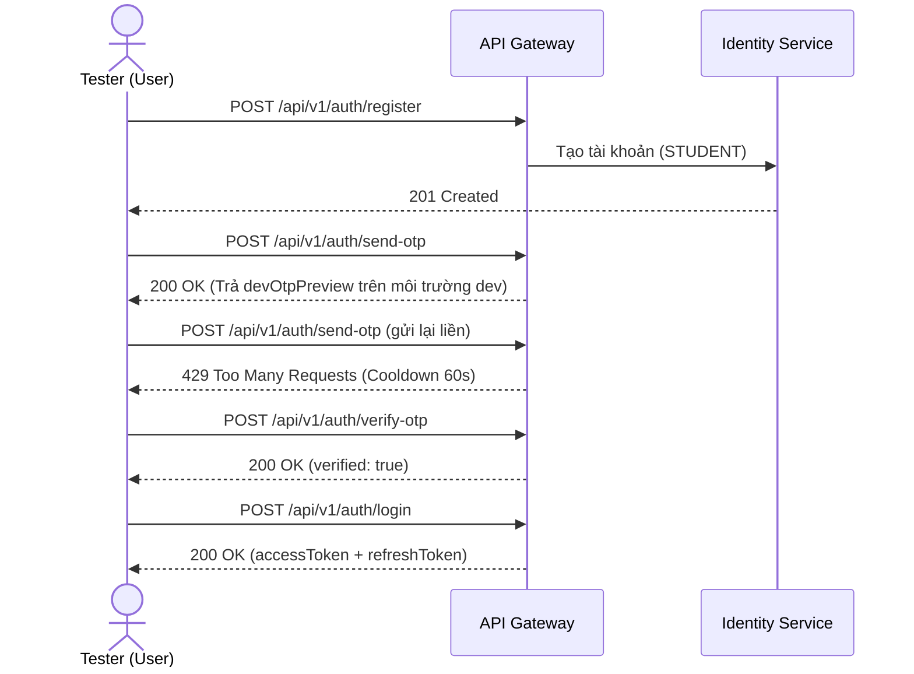
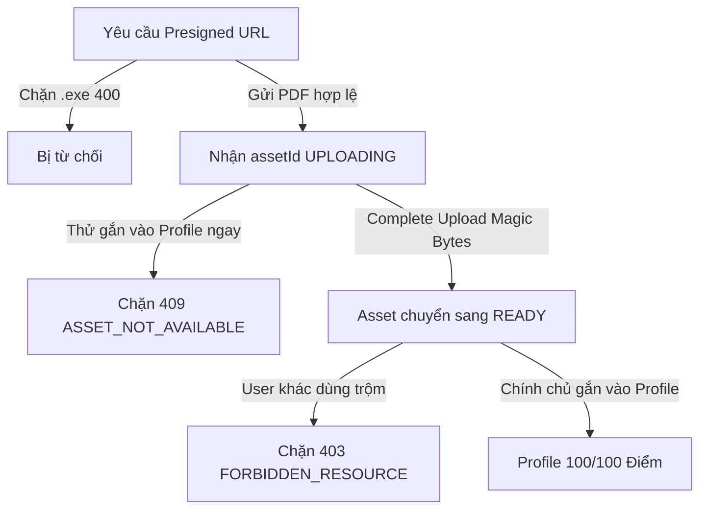
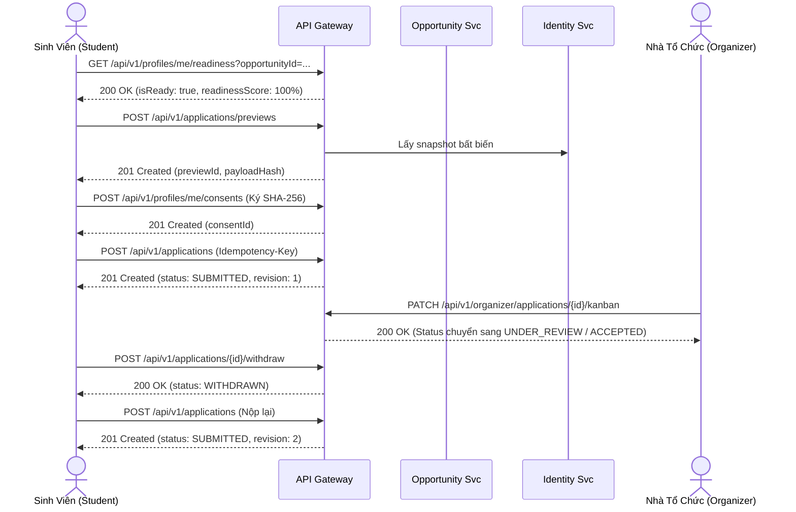
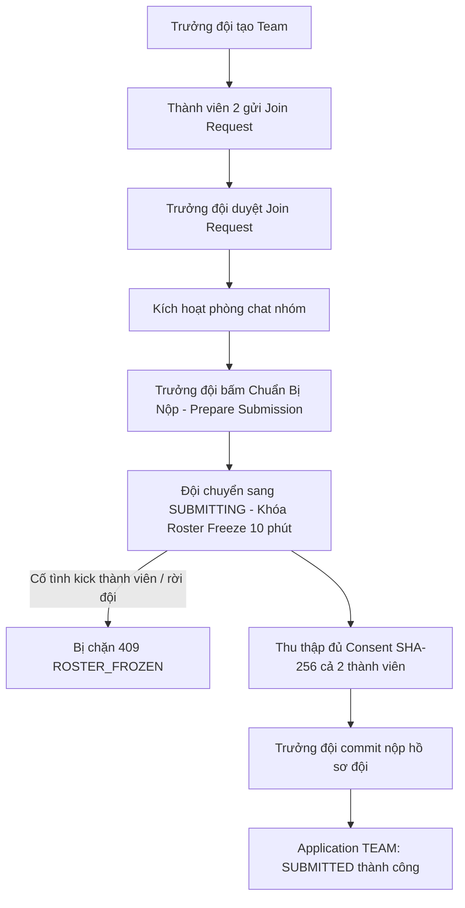
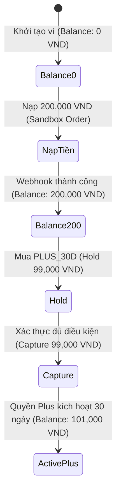

# 📋 Kịch Bản Kiểm Thử Quy Trình Nghiệp Vụ Thủ Công (Manual Test Workflow) — Scholink

> **Dự án:** Nền Tảng Học Bổng, Cuộc Thi & Đội Thi Sinh Viên Toàn Diện — **Scholink Microservices Ecosystem**  
> **Phiên bản tài liệu:** `v1.2` (Cập nhật chuẩn SRS v3.2 & Release v1.0.0)  
> **Mục tiêu:** Hướng dẫn chi tiết từng bước (Step-by-step) dành cho Tester, Developer hoặc Q&A để thực hiện kiểm thử thủ công ("test tay") toàn bộ các luồng nghiệp vụ cốt lõi từ đầu đến cuối (End-to-End).  
> **Phương thức thực hiện:** Thao tác qua **Giao diện Web Portal (`/portal`)**, **Swagger UI API Gateway (`/docs`)**, hoặc công cụ gọi API (**Postman / Thunder Client / Hoppscotch / cURL**).

---

## 📑 Mục Lục Kịch Bản Kiểm Thử

1. [Chuẩn Bị Môi Trường & Danh Sách Tài Khoản Thử Nghiệm](#1-chuẩn-bị-môi-trường--danh-sách-tài-khoản-thử-nghiệm)
2. [Workflow 01: Đăng Ký, OTP Email & Quản Lý Phiên (Auth & Session Flow)](#workflow-01-đăng-ký-otp-email--quản-lý-phiên-auth--session-flow)
3. [Workflow 02: Hoàn Thiện Passport 100 Điểm & Upload Tài Liệu An Toàn (Passport & Media Flow)](#workflow-02-hoàn-thiện-passport-100-điểm--upload-tài-liệu-an-toàn-passport--media-flow)
4. [Workflow 03: Quản Trị Tổ Chức & Đăng Tuyển Cơ Hội (Admin & Organizer Flow)](#workflow-03-quản-trị-tổ-chức--đăng-tuyển-cơ-hội-admin--organizer-flow)
5. [Workflow 04: Nộp Hồ Sơ Cá Nhân & Quản Lý Thẩm Định Kanban (Application & Review Flow)](#workflow-04-nộp-hồ-sơ-cá-nhân--quản-lý-thẩm-định-kanban-application--review-flow)
6. [Workflow 05: Tìm Đồng Đội & Nộp Hồ Sơ Đội Thi — Roster Freeze (Team-Up & Submission Flow)](#workflow-05-tìm-đồng-đội--nộp-hồ-sơ-đội-thi--roster-freeze-team-up--submission-flow)
7. [Workflow 06: Nhắn Tin Nhóm Thời Gian Thực & Thu Hồi Quyền Chat (Chat & Revocation Flow)](#workflow-06-nhắn-tin-nhóm-thời-gian-thực--thu-hồi-quyền-chat-chat--revocation-flow)
8. [Workflow 07: Ví Điện Tử, Nạp Tiền Sandbox & Mua Gói Dịch Vụ (Billing & Entitlement Flow)](#workflow-07-ví-điện-tử-nạp-tiền-sandbox--mua-gói-dịch-vụ-billing--entitlement-flow)
9. [Bảng Ma Trận Đánh Giá & Theo Dõi Tiến Độ Kiểm Thử (Manual Test Tracking Matrix)](#9-bảng-ma-trận-đánh-giá--theo-dõi-tiến-độ-kiểm-thử-manual-test-tracking-matrix)

---

## 1. Chuẩn Bị Môi Trường & Danh Sách Tài Khoản Thử Nghiệm

### 1.1. Khởi động hệ thống
Mở terminal tại thư mục gốc dự án:
```bash
# 1. Khởi động hạ tầng Docker (MongoDB, Redis, EMQX, RabbitMQ, MinIO)
docker compose up -d

# 2. Di chuyển vào thư mục backend, cài thư viện & seed dữ liệu mẫu
cd backend
pnpm install
pnpm run seed

# 3. Khởi động API Gateway (và các microservices nếu chạy riêng lẻ)
pnpm run start:gateway
# Hoặc khởi chạy đồng thời các service:
# pnpm run start:identity, pnpm run start:opportunity, pnpm run start:collaboration, pnpm run start:billing, pnpm run start:notification
```

### 1.2. Các cổng dịch vụ sử dụng để test tay
- 🌐 **Web Portal (Admin & Organizer Kanban):** `http://localhost:3000/portal`
- 📑 **Swagger UI tập trung (Khuyến nghị test tay API):** `http://localhost:3000/docs`
- 🎯 **MinIO S3 Web Console:** `http://localhost:9001` (`scholink_minio_admin` / `scholink_minio_password`)
- 📡 **EMQX Realtime Dashboard:** `http://localhost:18083` (`admin` / `public`)

### 1.3. Danh sách tài khoản có sẵn (Pre-seeded Accounts)
| Vai trò (Role) | Email đăng nhập | Mật khẩu mặc định | Mục đích sử dụng |
|---|---|---|---|
| **ADMIN** | `admin@scholink.edu.vn` | `ScholinkAdmin@2026` | Quản trị tổ chức đối tác, duyệt cơ hội, đình chỉ đơn vị |
| **ORGANIZER** | `organizer@scholink.edu.vn` | `Organizer@2026` | Tạo cơ hội học bổng/cuộc thi, kéo thẻ duyệt hồ sơ Kanban |
| **STUDENT 1** | `student@scholink.edu.vn` | `Student@2026` | Sinh viên đã có Passport 100 điểm, ví tiền sẵn có |
| **STUDENT 2** | *(Được tạo mới ở WF01)* | `StrongPassword@2026` | Dùng để test luồng từ đầu và ghép đội thi (Team-up) |

---

## Workflow 01: Đăng Ký, OTP Email & Quản Lý Phiên (Auth & Session Flow)

> **Mục tiêu:** Kiểm tra luồng tạo tài khoản Sinh viên, chống spam OTP, xác thực email, đăng nhập xoay vòng Refresh Token và chống Replay Attack.



### Các bước thực hiện:

#### Bước 1.1: Đăng ký tài khoản Sinh viên mới
- **Endpoint:** `POST /api/v1/auth/register`
- **Payload:**
```json
{
  "email": "test_student_01@scholink.edu.vn",
  "password": "StrongPassword@2026",
  "fullName": "Nguyễn Văn Test"
}
```
- **Kết quả mong đợi:**
  - HTTP `201 Created`
  - Body trả về: `{"id": "...", "email": "test_student_01@scholink.edu.vn", "role": "STUDENT"}`.

#### Bước 1.2: Kiểm tra chặn trùng email (Negative Case)
- **Thực hiện:** Gửi lại y hệt request tại Bước 1.1.
- **Kết quả mong đợi:**
  - HTTP `409 Conflict` (Mã lỗi `EMAIL_ALREADY_EXISTS`).

#### Bước 1.3: Yêu cầu gửi mã OTP xác thực Email
- **Endpoint:** `POST /api/v1/auth/send-otp`
- **Payload:**
```json
{
  "email": "test_student_01@scholink.edu.vn",
  "purpose": "VERIFY_EMAIL"
}
```
- **Kết quả mong đợi:**
  - HTTP `200 OK`.
  - Body trả về chứa `devOtpPreview` (ví dụ `"123456"` - mã OTP dev hiển thị để tiện test).

#### Bước 1.4: Kiểm tra chống Spam OTP (Cooldown 60 giây)
- **Thực hiện:** Bấm gửi lại `POST /api/v1/auth/send-otp` ngay lập tức trong vòng 60 giây.
- **Kết quả mong đợi:**
  - HTTP `429 Too Many Requests`.
  - Thông báo lỗi: Cooldown còn hiệu lực, yêu cầu chờ đợi.

#### Bước 1.5: Xác thực OTP Email
- **Endpoint:** `POST /api/v1/auth/verify-otp`
- **Payload:**
```json
{
  "email": "test_student_01@scholink.edu.vn",
  "otpCode": "<mã-otp-nhận-ở-bước-1.3>",
  "purpose": "VERIFY_EMAIL"
}
```
- **Kết quả mong đợi:**
  - HTTP `200 OK` (`{"verified": true}`).

#### Bước 1.6: Đăng nhập & Lấy JWT Token
- **Endpoint:** `POST /api/v1/auth/login`
- **Payload:**
```json
{
  "email": "test_student_01@scholink.edu.vn",
  "password": "StrongPassword@2026"
}
```
- **Kết quả mong đợi:**
  - HTTP `200 OK`.
  - Lưu lại: `accessToken` (dùng cho header `Authorization: Bearer <token>`) và `refreshToken`.

#### Bước 1.7: Kiểm tra Xoay vòng Refresh Token & Chống Tấn Công Dùng Lại (Replay Attack)
- **Endpoint:** `POST /api/v1/auth/refresh`
- **Payload:** `{"refreshToken": "<refreshToken_ở_bước_1.6>"}`
- **Kết quả mong đợi lần 1:** HTTP `200 OK`, trả về cặp Token mới (`accessToken_2`, `refreshToken_2`).
- **Thực hiện kiểm tra Replay:** Gửi lại `POST /api/v1/auth/refresh` với `refreshToken` cũ của lần đầu.
- **Kết quả mong đợi lần 2:** HTTP `401 Unauthorized` (Hệ thống phát hiện Replay Attack và lập tức hủy bỏ phiên làm việc).

---

## Workflow 02: Hoàn Thiện Passport 100 Điểm & Upload Tài Liệu An Toàn (Passport & Media Flow)

> **Mục tiêu:** Kiểm tra cơ chế tải lên tài liệu an toàn (MIME validation, chặn file exe, quét virus, chuyển trạng thái READY), ngăn chặn dùng tài liệu của người khác (IDOR) và hoàn thiện hồ sơ sinh viên đạt điểm tuyệt đối 100/100 kèm khóa lạc quan `expectedVersion`.



### Các bước thực hiện:

#### Bước 2.1: Kiểm tra chặn file độc hại / Sai định dạng MIME (Negative Case)
- **Header:** `Authorization: Bearer <accessToken>`
- **Endpoint:** `POST /api/v1/media/upload-url`
- **Payload:**
```json
{
  "category": "CV",
  "fileName": "trojan_virus.exe",
  "mimeType": "application/x-msdownload",
  "sizeBytes": 2048
}
```
- **Kết quả mong đợi:** HTTP `400 Bad Request` (Chặn MIME type không được phép).

#### Bước 2.2: Khởi tạo tải lên tài liệu CV (PDF)
- **Endpoint:** `POST /api/v1/media/upload-url`
- **Payload:**
```json
{
  "category": "CV",
  "fileName": "cv_sinh_vien.pdf",
  "mimeType": "application/pdf",
  "sizeBytes": 256000
}
```
- **Kết quả mong đợi:**
  - HTTP `201 Created`.
  - Trả về `assetId` (ví dụ `ast_123456`) và trạng thái `status: "UPLOADING"`.

#### Bước 2.3: Kiểm tra tính bất biến trạng thái — Chặn gán Asset chưa READY (Negative Case)
- **Thực hiện:** Thử gọi cập nhật Passport với `cvAssetId` vừa tạo khi chưa xác nhận tải lên:
- **Endpoint:** `PUT /api/v1/profiles/me`
- **Payload:** `{"cvAssetId": "<assetId_vừa_tạo>"}`
- **Kết quả mong đợi:** HTTP `409 Conflict` (Lỗi `ASSET_NOT_AVAILABLE`: Không thể gắn tài liệu khi chưa xử lý xong).

#### Bước 2.4: Xác nhận hoàn tất tải lên & Kiểm tra Magic Bytes
- **Endpoint:** `POST /api/v1/media/<assetId>/complete`
- **Payload:**
```json
{
  "fileHeaderHex": "255044462d312e37",
  "sampleContent": "%PDF-1.7 Clean Academic CV Content",
  "actualSizeBytes": 256000
}
```
- **Kết quả mong đợi:**
  - HTTP `200 OK`.
  - Trạng thái `status` của tài liệu chuyển sang `"READY"`.

#### Bước 2.5: Kiểm tra chống BOLA/IDOR — Không cho dùng Asset người khác
- **Thực hiện:** Đăng nhập bằng tài khoản `student@scholink.edu.vn` (User B), gọi `PUT /api/v1/profiles/me` gắn `cvAssetId` của User A.
- **Kết quả mong đợi:** HTTP `403 Forbidden` (`FORBIDDEN_RESOURCE`).

#### Bước 2.6: Cập nhật thông tin Passport 7 thành phần đạt 100/100 Điểm
- **Header:** `Authorization: Bearer <accessToken_User_A>`
- **Endpoint:** `PUT /api/v1/profiles/me`
- **Payload:**
```json
{
  "expectedVersion": 1,
  "fullName": "Nguyễn Văn Test",
  "bio": "Sinh viên đam mê trí tuệ nhân tạo và hệ thống phân tán",
  "regionCode": "VN-SG",
  "avatarAssetId": "<assetId_ở_bước_2.4>",
  "cvAssetId": "<assetId_ở_bước_2.4>",
  "education": {
    "institution": "Đại học Bách Khoa TP.HCM",
    "major": "Khoa học Máy tính",
    "startYear": 2023,
    "gpa": 3.85,
    "gpaScale": 4.0
  },
  "skills": ["TypeScript", "NestJS", "Docker", "Python"],
  "certificates": [
    {
      "type": "LANGUAGE",
      "name": "IELTS Academic",
      "score": "8.0",
      "issuedDate": "2025-01-15T00:00:00.000Z"
    }
  ],
  "achievements": ["Giải Nhất Olympic Tin học Sinh viên"],
  "isLookingForTeammate": true,
  "isOpenForScholarship": true,
  "isOpenForMentoring": false
}
```
- **Kết quả mong đợi:**
  - HTTP `200 OK`.
  - Điểm hoàn thiện `completionScore`: **`100`** (Cơ bản 20 + Học vấn 25 + Chứng chỉ 10 + Thành tích 15 + Kỹ năng 15 + CV/Media 5 + Ý định 10).
  - Phiên bản hồ sơ `profileVersion` tăng lên `2`.

#### Bước 2.7: Kiểm tra khóa lạc quan (Optimistic Lock)
- **Thực hiện:** Gửi lại request trên nhưng giữ nguyên `"expectedVersion": 1` (phiên bản cũ).
- **Kết quả mong đợi:** HTTP `409 Conflict` (Lỗi `VERSION_MISMATCH`).

---

## Workflow 03: Quản Trị Tổ Chức & Đăng Tuyển Cơ Hội (Admin & Organizer Flow)

> **Mục tiêu:** Kiểm tra quyền quản trị đa đơn vị (Tenant Isolation), Admin cấp quyền Organizer, Organizer tạo cơ hội học bổng/cuộc thi và Admin phê duyệt xuất bản.

### Các bước thực hiện:

#### Bước 3.1: Đăng nhập tài khoản Quản Trị Viên (Admin)
- **Endpoint:** `POST /api/v1/auth/login`
- **Payload:** `{"email": "admin@scholink.edu.vn", "password": "ScholinkAdmin@2026"}`
- **Kết quả:** Nhận `adminToken`.

#### Bước 3.2: Admin tạo Tổ chức đối tác mới
- **Header:** `Authorization: Bearer <adminToken>`
- **Endpoint:** `POST /api/v1/admin/organizations`
- **Payload:**
```json
{
  "name": "Đại Học Công Nghệ Thông Tin - ĐHQG-HCM",
  "code": "UIT_VNU",
  "contactEmail": "contact@uit.edu.vn",
  "website": "https://uit.edu.vn"
}
```
- **Kết quả mong đợi:** HTTP `201 Created`, lưu lại `organizationId`.

#### Bước 3.3: Admin gán người dùng làm Organizer của Tổ chức
- **Endpoint:** `POST /api/v1/admin/organizations/<organizationId>/members`
- **Payload:**
```json
{
  "email": "organizer@scholink.edu.vn",
  "role": "ORGANIZER"
}
```
- **Kết quả mong đợi:** HTTP `201 Created`.

#### Bước 3.4: Đăng nhập tài khoản Organizer
- **Endpoint:** `POST /api/v1/auth/login`
- **Payload:** `{"email": "organizer@scholink.edu.vn", "password": "Organizer@2026"}`
- **Kết quả:** Nhận `organizerToken`.

#### Bước 3.5: Organizer tạo bản nháp Cơ hội Học bổng (DRAFT)
- **Header:** `Authorization: Bearer <organizerToken>`
- **Endpoint:** `POST /api/v1/admin/opportunities`
- **Payload:**
```json
{
  "title": "Học Bổng Tài Năng Công Nghệ Tương Lai 2026",
  "type": "SCHOLARSHIP",
  "applyMode": "IN_APP",
  "description": "Dành cho sinh viên ngành CNTT có GPA >= 3.6 và IELTS >= 6.5",
  "deadline": "2026-12-31T23:59:59.000Z",
  "slots": 10,
  "awardValueVnd": 50000000,
  "requirements": {
    "minGpa": 3.6,
    "requiredSkills": ["Python", "TypeScript"]
  }
}
```
- **Kết quả mong đợi:**
  - HTTP `201 Created`.
  - Trạng thái `status`: `"DRAFT"`, lưu lại `opportunityId`.

#### Bước 3.6: Organizer gửi duyệt cơ hội (Submit for Review)
- **Endpoint:** `POST /api/v1/admin/opportunities/<opportunityId>/submit-review`
- **Kết quả mong đợi:** HTTP `200 OK`, trạng thái chuyển sang `"PENDING_REVIEW"`.

#### Bước 3.7: Admin phê duyệt xuất bản cơ hội (Publish)
- **Header:** `Authorization: Bearer <adminToken>`
- **Endpoint:** `POST /api/v1/admin/opportunities/<opportunityId>/publish`
- **Payload:** `{"approved": true}`
- **Kết quả mong đợi:**
  - HTTP `200 OK`.
  - Trạng thái chuyển sang `"PUBLISHED"`. Cơ hội hiện hữu trên bảng tìm kiếm công khai của sinh viên.

---

## Workflow 04: Nộp Hồ Sơ Cá Nhân & Quản Lý Thẩm Định Kanban (Application & Review Flow)

> **Mục tiêu:** Kiểm tra luồng nộp hồ sơ cá nhân với đầy đủ cơ chế Preview bất biến, chữ ký thỏa thuận chia sẻ dữ liệu (Consent SHA-256), nộp hồ sơ chính thức, Organizer kéo thẻ thẩm định trên Kanban Web Portal, sinh viên rút đơn và nộp lại bản sửa đổi (Revision 2).



### Các bước thực hiện:

#### Bước 4.1: Kiểm tra độ sẵn sàng ứng tuyển (Readiness & Screening)
- **Header:** `Authorization: Bearer <studentToken>`
- **Endpoint:** `GET /api/v1/profiles/me/readiness?opportunityId=<opportunityId>`
- **Kết quả mong đợi:**
  - HTTP `200 OK`.
  - Body: `{"isReady": true, "readinessScore": 100, "screening": "PASS"}`.

#### Bước 4.2: Tạo bản xem trước hồ sơ bất biến (Generate Preview)
- **Endpoint:** `POST /api/v1/applications/previews`
- **Payload:**
```json
{
  "opportunityId": "<opportunityId>",
  "submissionId": "sub_manual_test_01",
  "attachmentIds": ["<assetId_cv_ở_bước_2.4>"],
  "expectedRuleVersion": 1
}
```
- **Kết quả mong đợi:**
  - HTTP `201 Created`.
  - Nhận về: `previewId`, `snapshotId`, `manifestHash`, `payloadHash`.

#### Bước 4.3: Ký xác nhận Thỏa thuận Chia sẻ Dữ liệu (Consent SHA-256)
- **Endpoint:** `POST /api/v1/profiles/me/consents`
- **Payload:**
```json
{
  "opportunityId": "<opportunityId>",
  "submissionId": "sub_manual_test_01",
  "previewId": "<previewId_ở_bước_4.2>",
  "snapshotId": "<snapshotId_ở_bước_4.2>",
  "profileVersion": 2,
  "ruleVersion": 1,
  "manifestHash": "<manifestHash_ở_bước_4.2>",
  "payloadHash": "<payloadHash_ở_bước_4.2>"
}
```
- **Kết quả mong đợi:**
  - HTTP `201 Created`.
  - Trả về `consentId` (chứng thực sinh viên đã chấp thuận ủy quyền snapshot hồ sơ).

#### Bước 4.4: Nộp hồ sơ ứng tuyển chính thức (Revision 1)
- **Header:** Gắn thêm header chống lặp: `Idempotency-Key: idem_manual_001`
- **Endpoint:** `POST /api/v1/applications`
- **Payload:**
```json
{
  "opportunityId": "<opportunityId>",
  "submissionId": "sub_manual_test_01",
  "submissionType": "INDIVIDUAL",
  "previewId": "<previewId>",
  "snapshotId": "<snapshotId>",
  "profileVersion": 2,
  "expectedRuleVersion": 1,
  "payloadHash": "<payloadHash>",
  "consentId": "<consentId>"
}
```
- **Kết quả mong đợi:**
  - HTTP `201 Created`.
  - `status`: `"SUBMITTED"`, `revision`: `1`, lưu lại `applicationId`.

#### Bước 4.5: Organizer thẩm định hồ sơ trên Web Portal Kanban
- **Thao tác trên giao diện trực quan:**
  1. Mở trình duyệt truy cập: **`http://localhost:3000/portal#kanban`**.
  2. Đăng nhập với tài khoản: `organizer@scholink.edu.vn` / `Organizer@2026`.
  3. Chọn cơ hội học bổng tương ứng. Thấy thẻ hồ sơ của "Nguyễn Văn Test" nằm tại cột **SUBMITTED**.
  4. Kéo thẻ sang cột **UNDER_REVIEW**.
  5. Thử chuyển sang **REJECTED**: Hệ thống bắt buộc phải nhập lý do từ chối (Rejection Reason), nếu để trống sẽ bị từ chối 422.
  6. Kéo thẻ sang cột **ACCEPTED** (hoặc **SHORTLISTED**).
- **Hoặc thực hiện qua API (nếu không dùng Web Portal):**
  - **Endpoint:** `PATCH /api/v1/organizer/applications/<applicationId>/kanban`
  - **Payload:**
  ```json
  {
    "newStatus": "UNDER_REVIEW",
    "expectedVersion": 1
  }
  ```
  - **Kết quả mong đợi:** HTTP `200 OK`.

#### Bước 4.6: Sinh viên kiểm tra chi tiết đơn & Lịch sử thẩm định
- **Endpoint:** `GET /api/v1/applications/<applicationId>`
- **Kết quả mong đợi:**
  - HTTP `200 OK`.
  - Xem được dòng thời gian (Timeline) và trạng thái thẩm định mới nhất.

#### Bước 4.7: Sinh viên rút hồ sơ (Withdraw)
- **Endpoint:** `POST /api/v1/applications/<applicationId>/withdraw`
- **Kết quả mong đợi:**
  - HTTP `200 OK`.
  - Trạng thái `status` chuyển thành `"WITHDRAWN"`.

#### Bước 4.8: Nộp lại hồ sơ sau khi rút (Revision 2)
- **Header:** `Idempotency-Key: idem_manual_002`
- **Endpoint:** `POST /api/v1/applications`
- **Payload:** Giữ nguyên các thông tin, đổi `submissionId: "sub_manual_test_02"`.
- **Kết quả mong đợi:**
  - HTTP `201 Created`.
  - `status`: `"SUBMITTED"`, `revision`: **`2`** (Hệ thống không tạo bản ghi mới mà nâng số revision để quản lý lịch sử).

---

## Workflow 05: Tìm Đồng Đội & Nộp Hồ Sơ Đội Thi — Roster Freeze (Team-Up & Submission Flow)

> **Mục tiêu:** Kiểm tra luồng tạo đội thi (Team), mời thành viên, kích hoạt phòng chat nhóm, thực hiện quy trình nộp đội hai pha (Two-phase Team Submission), khóa danh sách thành viên (Roster Freeze 10 phút) và giải phóng khóa an toàn.



### Các bước thực hiện:

#### Bước 5.1: Trưởng đội (Student A) tạo Đội thi
- **Header:** `Authorization: Bearer <token_Student_A>`
- **Endpoint:** `POST /api/v1/teams`
- **Payload:**
```json
{
  "name": "Đội Thi Trí Tuệ Nhân Tạo BK",
  "opportunityId": "<opportunityId>",
  "maxMembers": 3,
  "description": "Đội thi lập trình AI phân tán và xử lý ngôn ngữ tự nhiên"
}
```
- **Kết quả mong đợi:**
  - HTTP `201 Created`.
  - Lưu lại `teamId` (ví dụ `team_001`), tự động gán `chatRoomId` tương ứng.

#### Bước 5.2: Sinh viên B (Student B) gửi yêu cầu tham gia đội
- **Header:** `Authorization: Bearer <token_Student_B>`
- **Endpoint:** `POST /api/v1/teams/<teamId>/join-requests`
- **Payload:** `{"message": "Chào bạn, mình có kinh nghiệm làm Backend NestJS muốn tham gia đội"}`
- **Kết quả mong đợi:** HTTP `201 Created`, lưu `requestId`.

#### Bước 5.3: Trưởng đội duyệt yêu cầu gia nhập
- **Header:** `Authorization: Bearer <token_Student_A>`
- **Endpoint:** `POST /api/v1/teams/<teamId>/join-requests/<requestId>/accept`
- **Kết quả mong đợi:**
  - HTTP `200 OK`.
  - Sinh viên B chính thức trở thành thành viên (MEMBER) của đội.

#### Bước 5.4: Trưởng đội kích hoạt phiên chuẩn bị nộp đội (Prepare Submission)
- **Endpoint:** `POST /api/v1/teams/<teamId>/prepare-submission`
- **Kết quả mong đợi:**
  - HTTP `200 OK`.
  - Nhận `rosterVersion: 1`, `submissionLeaseExpiredAt` (thời hạn khóa 10 phút).
  - Trạng thái đội chuyển sang **`SUBMITTING`** (**Roster Freeze kích hoạt**).

#### Bước 5.5: Kiểm tra tính nghiêm ngặt của Roster Freeze (Negative Case)
- **Thực hiện:** Sinh viên B cố tình gọi API rời đội (`POST /api/v1/teams/<teamId>/leave`) hoặc Trưởng đội thử kích thành viên khi đang nộp.
- **Kết quả mong đợi:**
  - HTTP `409 Conflict` (Lỗi `ROSTER_FROZEN`: Đội đang trong quá trình chốt hồ sơ nộp, cấm thay đổi danh sách thành viên).

#### Bước 5.6: Toàn bộ thành viên ký xác nhận chia sẻ dữ liệu (Team Consents)
- **Cả Student A và Student B** lần lượt gọi API tạo Consent gắn với `teamId` và `rosterVersion`:
- **Endpoint:** `POST /api/v1/profiles/me/consents`
- **Payload:**
```json
{
  "opportunityId": "<opportunityId>",
  "teamId": "<teamId>",
  "rosterVersion": 1,
  "payloadHash": "<payloadHash>"
}
```
- **Kết quả mong đợi:** Cả hai thành viên đều nhận HTTP `201 Created`.

#### Bước 5.7: Trưởng đội hoàn tất nộp hồ sơ đội
- **Header:** `Authorization: Bearer <token_Student_A>`
- **Endpoint:** `POST /api/v1/applications`
- **Payload:**
```json
{
  "opportunityId": "<opportunityId>",
  "teamId": "<teamId>",
  "submissionType": "TEAM",
  "rosterVersion": 1,
  "consents": ["<consentId_Student_A>", "<consentId_Student_B>"]
}
```
- **Kết quả mong đợi:**
  - HTTP `201 Created`.
  - Trạng thái đội chuyển sang `"SUBMITTED"`.

---

## Workflow 06: Nhắn Tin Nhóm Thời Gian Thực & Thu Hồi Quyền Chat (Chat & Revocation Flow)

> **Mục tiêu:** Kiểm tra gửi/nhận tin nhắn trong phòng chat đội thi, tính tuần tự tăng đơn điệu (monotonic sequence), chống trùng lặp qua `clientMsgId`, và thu hồi ngay lập tức quyền đọc/gửi tin nhắn khi thành viên rời đội.

### Các bước thực hiện:

#### Bước 6.1: Gửi tin nhắn vào phòng chat đội thi
- **Header:** `Authorization: Bearer <token_Student_A>`
- **Endpoint:** `POST /api/v1/chats/rooms/<chatRoomId>/messages`
- **Payload:**
```json
{
  "clientMsgId": "msg_uuid_001",
  "content": "Chào cả đội, hôm nay chúng ta hoàn thiện đề tài nhé!"
}
```
- **Kết quả mong đợi:**
  - HTTP `201 Created`.
  - Nhận về `seq: 1`, `serverTimestamp`.

#### Bước 6.2: Kiểm tra chống trùng lặp tin nhắn (Deduplication)
- **Thực hiện:** Gửi lại y hệt payload với cùng `clientMsgId: "msg_uuid_001"`.
- **Kết quả mong đợi:**
  - HTTP `200 OK` hoặc `201 Created` trả về chính tin nhắn cũ, không tạo thêm bản ghi mới với `seq: 2`.

#### Bước 6.3: Thành viên B xem lịch sử tin nhắn
- **Header:** `Authorization: Bearer <token_Student_B>`
- **Endpoint:** `GET /api/v1/chats/rooms/<chatRoomId>/messages?limit=20`
- **Kết quả mong đợi:**
  - HTTP `200 OK`.
  - Nhận danh sách tin nhắn, chứa nội dung Student A vừa gửi.

#### Bước 6.4: Rút/Rời đội & Kiểm tra Thu hồi quyền Chat (Chat Revocation)
- **Thực hiện:**
  1. Sau khi cuộc thi kết thúc hoặc hủy nộp, Sinh viên B rời đội: `POST /api/v1/teams/<teamId>/leave`.
  2. Sinh viên B thử gửi tin nhắn mới vào phòng chat:
     - `POST /api/v1/chats/rooms/<chatRoomId>/messages`
     - **Kết quả mong đợi:** HTTP `403 Forbidden` (`NOT_TEAM_MEMBER`).
  3. Sinh viên B thử đọc lại tin nhắn:
     - `GET /api/v1/chats/rooms/<chatRoomId>/messages`
     - **Kết quả mong đợi:** HTTP `403 Forbidden` (Quyền truy cập phòng chat bị thu hồi tức thì).

---

## Workflow 07: Ví Điện Tử, Nạp Tiền Sandbox & Mua Gói Dịch Vụ (Billing & Entitlement Flow)

> **Mục tiêu:** Kiểm tra bất biến tài chính ví tiền (`availableVnd = balance - held >= 0`), nạp tiền sandbox qua webhook an toàn, mua gói dịch vụ SKU `PLUS_30D` theo quy trình hai bước Giữ tiền (Hold) -> Thu tiền (Capture).



### Các bước thực hiện:

#### Bước 7.1: Kiểm tra số dư ví hiện tại
- **Header:** `Authorization: Bearer <studentToken>`
- **Endpoint:** `GET /api/v1/wallet`
- **Kết quả mong đợi:**
  - HTTP `200 OK`.
  - Body trả về: `{"balanceVnd": ..., "heldVnd": ..., "availableVnd": ...}`.
  - Luôn đảm bảo quy tắc: `availableVnd = balanceVnd - heldVnd`.

#### Bước 7.2: Tạo yêu cầu nạp tiền VietQR PayOS
- **Endpoint:** `POST /api/v1/payments/topups`
- **Header:** `Idempotency-Key: topup_payos_manual_01`
- **Payload:**
```json
{
  "amountVnd": 100000,
  "provider": "PAYOS"
}
```
- **Kết quả mong đợi:**
  - HTTP `201 Created`.
  - Nhận về `orderId`, `orderCode` (dạng số nguyên), `checkoutUrl` và mã VietQR `qrCode` chứa ảnh mã QR Napas 24/7.

#### Bước 7.3: Xử lý Webhook thanh toán PayOS (Server-to-Server Callback)
- **Endpoint:** `POST /api/v1/payments/webhook/payos`
- **Payload:**
```json
{
  "code": "00",
  "desc": "success",
  "data": {
    "orderCode": <orderCode_ở_bước_7.2>,
    "amount": 100000,
    "description": "Scholink nap 100k",
    "accountNumber": "123456789",
    "reference": "TRANS_PAYOS_999",
    "transactionDateTime": "2026-11-21 20:30:00"
  }
}
```
- **Kết quả mong đợi:**
  - HTTP `200 OK` (`{"processed": true, "status": "SUCCEEDED", "newBalanceVnd": ...}`).
  - Thử gửi lại webhook lần 2 ➔ Hệ thống trả về `{"alreadyProcessed": true}`, bảo đảm nguyên tắc Idempotent không bị cộng tiền x2.

#### Bước 7.4: Kiểm tra trạng thái đơn nạp & Xác nhận số dư ví tăng chính xác
- **Endpoint:** `GET /api/v1/payments/orders/<orderId>/status`
- **Kết quả mong đợi:**
  - HTTP `200 OK`, `status: "SUCCEEDED"`.
  - Gọi lại `GET /api/v1/wallet`: `balanceVnd` và `availableVnd` tăng đúng 100.000 VND.

#### Bước 7.5: Kiểm thử trên Ứng dụng Di Động (Mobile Flutter App)
1. Mở ứng dụng Flutter, đăng nhập tài khoản Sinh viên (`student@scholink.edu.vn`).
2. Vào tab **Passport**, bấm vào mục **"Ví tiền & Nạp VietQR (PayOS)"**.
3. Màn hình **WalletView** hiển thị:
   - Thẻ số dư ví gradient sắc nét với số dư khả dụng to rõ.
   - Chọn nhanh mệnh giá nạp (50k, 100k, 200k, 500k).
   - Bấm nút **"Tạo Mã VietQR Nạp tiền"** ➔ Mở modal chứa hình ảnh mã VietQR Napas 24/7, mã đơn và nút Mở cổng PayOS.
   - Ứng dụng tự động kích hoạt polling trạng thái: ngay khi webhook thành công, modal chuyển sang trạng thái chúc mừng và cập nhật số dư tức thì!
   - Thử mua gói dịch vụ **"Scholink Plus (1 Tháng - 49.000đ)"** ➔ Bấm "Mua ngay" ➔ Xác nhận trừ tiền ví thành công.

#### Bước 7.5: Mua gói tính năng cao cấp PLUS_30D (99,000 VND)
- **Endpoint:** `POST /api/v1/wallets/me/purchases`
- **Payload:**
```json
{
  "sku": "PLUS_30D",
  "idempotencyKey": "purchase_plus_manual_01"
}
```
- **Kết quả mong đợi:**
  - HTTP `201 Created`.
  - Hệ thống thực hiện Hold 99,000 VND -> Capture -> Ghi sổ kép (Double-entry ledger).
  - Trạng thái gói: `"ACTIVE"`.
  - Gọi lại `GET /api/v1/wallets/me`: `balance` giảm đúng `99,000 VND`, `held` trở về `0`.

---

## 9. Bảng Ma Trận Đánh Giá & Theo Dõi Tiến Độ Kiểm Thử (Manual Test Tracking Matrix)

Dành cho Tester tích chọn `[x]` khi nghiệm thu thực tế:

| Mã Ca (Test ID) | Nghiệp Vụ Cần Đạt | Kết Quả Mong Đợi Chính | Trạng Thái | Ghi Chú / Lỗi Phát Sinh |
|:---:|---|---|:---:|---|
| **AUTH-01** | Đăng ký tài khoản Sinh viên mới | HTTP 201, Role STUDENT | [ ] Đạt | |
| **AUTH-02** | Chặn đăng ký trùng email | HTTP 409 EMAIL_ALREADY_EXISTS | [ ] Đạt | |
| **AUTH-03** | Gửi OTP & chặn spam trong 60s | HTTP 200 và chặn 429 nếu spam | [ ] Đạt | |
| **AUTH-04** | Đăng nhập & Xoay vòng Refresh Token | HTTP 200 trả Token mới | [ ] Đạt | |
| **AUTH-05** | Chặn tấn công Replay Token cũ | HTTP 401 Unauthorized | [ ] Đạt | |
| **PROF-01** | Chặn upload file `.exe` / sai MIME | HTTP 400 Bad Request | [ ] Đạt | |
| **PROF-02** | Upload PDF & quét an toàn chuyển READY | HTTP 200 Status READY | [ ] Đạt | |
| **PROF-03** | Chặn dùng trộm Asset người khác (IDOR) | HTTP 403 Forbidden | [ ] Đạt | |
| **PROF-04** | Hoàn thiện Passport 7 phần = 100 điểm | HTTP 200, Score 100 | [ ] Đạt | |
| **PROF-05** | Chặn sai expectedVersion hồ sơ | HTTP 409 VERSION_MISMATCH | [ ] Đạt | |
| **ORG-01** | Admin tạo Tổ chức & gán Organizer | HTTP 201 Created | [ ] Đạt | |
| **ORG-02** | Organizer tạo cơ hội DRAFT & gửi duyệt | HTTP 201 và chuyển PENDING | [ ] Đạt | |
| **ORG-03** | Admin duyệt xuất bản cơ hội | HTTP 200 chuyển PUBLISHED | [ ] Đạt | |
| **APP-01** | Kiểm tra Readiness & dự báo Screening | isReady: true, PASS | [ ] Đạt | |
| **APP-02** | Tạo Preview bất biến & Ký Consent SHA-256 | Có previewId và consentId | [ ] Đạt | |
| **APP-03** | Nộp hồ sơ chính thức (Revision 1) | HTTP 201, Status SUBMITTED | [ ] Đạt | |
| **APP-04** | Thẩm định Kanban trên Web Portal | Kéo thẻ & bắt buộc lý do từ chối | [ ] Đạt | |
| **APP-05** | Rút hồ sơ (Withdraw) | HTTP 200, Status WITHDRAWN | [ ] Đạt | |
| **APP-06** | Nộp lại hồ sơ (Revision 2) | HTTP 201, Revision tăng lên 2 | [ ] Đạt | |
| **TEAM-01** | Tạo đội thi & duyệt thành viên mới | HTTP 201 Created | [ ] Đạt | |
| **TEAM-02** | Kích hoạt Roster Freeze khi nộp đội | Status SUBMITTING (10 phút) | [ ] Đạt | |
| **TEAM-03** | Chặn rời đội / kích người khi Freeze | HTTP 409 ROSTER_FROZEN | [ ] Đạt | |
| **TEAM-04** | Thu thập đủ Consent & Nộp đội thành công | HTTP 201 Application TEAM | [ ] Đạt | |
| **CHAT-01** | Gửi tin nhắn thời gian thực | HTTP 201, seq tăng đơn điệu | [ ] Đạt | |
| **CHAT-02** | Chống trùng tin nhắn clientMsgId | Không nhân bản tin nhắn | [ ] Đạt | |
| **CHAT-03** | Thu hồi quyền chat khi rời đội | HTTP 403 Forbidden | [ ] Đạt | |
| **BILL-01** | Nạp tiền ví Sandbox | Cộng đúng số dư VND | [ ] Đạt | |
| **BILL-02** | Mua gói PLUS_30D (Hold -> Capture) | Trừ tiền & kích hoạt gói ACTIVE | [ ] Đạt | |

---

> [!TIP]
> **Khuyến nghị kiểm thử:** Để thuận tiện nhất, bạn có thể mở đồng thời 2 tab trình duyệt:
> 1. Tab 1: **Web Portal** ([`http://localhost:3000/portal`](http://localhost:3000/portal)) để trực quan hóa thao tác của Admin & Organizer.
> 2. Tab 2: **Swagger UI** ([`http://localhost:3000/docs`](http://localhost:3000/docs)) để thực thi nhanh các request của Sinh viên (Student) bằng nút **"Try it out"**.
