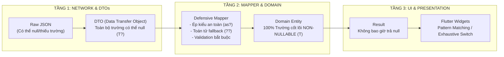

# 📘 TÀI LIỆU THIẾT KẾ KIẾN TRÚC FLUTTER OOP & PHÒNG THỦ NULL-SAFETY TOÀN DIỆN
### Dự án: Nền tảng Di động Scholink (Scholink Mobile Platform)
### Phiên bản: 1.0 — Chuẩn hóa chuyển đổi từ Android Native sang Flutter

---

## 📑 MỤC LỤC

1. [Mục Tiêu & Tiêu Chuẩn Kỹ Thuật](#1-mục-tiêu--tiêu-chuẩn-kỹ-thuật)
2. [Chiến Lược Áp Dụng Lập Trình Hướng Đối Tượng (OOP) & SOLID](#2-chiến-lược-áp-dụng-lập-trình-hướng-đối-tượng-oop--solid)
3. [Chiến Lược Phòng Thủ Nullable Check Toàn Diện (Defensive Null-Safety)](#3-chiến-lược-phòng-thủ-nullable-check-toàn-diện-defensive-null-safety)
4. [Cấu Trúc Thư Mục Clean Architecture (Feature-First)](#4-cấu-trúc-thư-mục-clean-architecture-feature-first)
5. [Tầng Core: Mạng, Bảo Mật, Lưu Trữ & Realtime](#5-tầng-core-mạng-bảo-mật-lưu-trữ--realtime)
6. [Tầng Data: DTOs, Defensive Parsing & Mappers](#6-tầng-data-dtos-defensive-parsing--mappers)
7. [Tầng Domain: Entities, Value Objects & Use Cases](#7-tầng-domain-entities-value-objects--use-cases)
8. [Tầng Presentation: BLoC Pattern & Null-Safe UI Rendering](#8-tầng-presentation-bloc-pattern--null-safe-ui-rendering)
9. [Bảng Đối Chiếu Thành Phần (Android Native ➔ Flutter)](#9-bảng-đối-chiếu-thành-phần-android-native--flutter)
10. [Lộ Trình & Kế Hoạch Triển Khai (Roadmap)](#10-lộ-trình--kế-hoạch-triển-khai-roadmap)

---

## 1. MỤC TIÊU & TIÊU CHUẨN KỸ THUẬT

### 1.1. Mục Tiêu Chuyển Đổi (Refactoring Goal)
Chuyển đổi toàn bộ ứng dụng di động từ **Android Native (Kotlin + Jetpack Compose)** sang **Flutter (Dart 3.x)** nhằm:
- **Đa nền tảng:** Hỗ trợ đồng thời cả Android và iOS từ một codebase duy nhất.
- **Tuân thủ chuẩn mực OOP nghiêm ngặt:** Áp dụng đầy đủ 4 trụ cột OOP, nguyên lý SOLID, mẫu thiết kế GoF và Clean Architecture.
- **Phòng thủ Null-Safety tuyệt đối (Zero NullPointer / Unhandled Null):** Kiểm tra, bao bọc và xử lý toàn bộ giá trị có thể `null` từ tầng mạng, cơ sở dữ liệu nội bộ đến tầng giao diện người dùng.

### 1.2. Tiêu Chuẩn Dart Analyzer (analysis_options.yaml)
Bắt buộc kích hoạt chế độ kiểm tra tĩnh nghiêm ngặt nhất của Dart 3:
```yaml
analyzer:
  language:
    strict-casts: true        # Cấm ép kiểu ngầm định (ép kiểu không an toàn)
    strict-inference: true    # Bắt buộc trình biên dịch phải suy luận kiểu chính xác
    strict-raw-types: true    # Cấm dùng generic dạng thô (ví dụ: List thay vì List<T>)
  errors:
    missing_required_param: error
    missing_return: error
    todo: ignore
    invalid_annotation_target: ignore
```

---

## 2. CHIẾN LƯỢC ÁP DỤNG LẬP TRÌNH HƯỚNG ĐỐI TƯỢNG (OOP) & SOLID

### 2.1. Bốn Trụ Cột OOP Trong Flutter/Dart

```mermaid
graph TD
    subgraph OOP["4 TRỤ CỘT OOP TRONG DỰ ÁN SCHOLINK FLUTTER"]
        E["1. ENCAPSULATION (Đóng gói)"]
        A["2. ABSTRACTION (Trừu tượng hóa)"]
        I["3. INHERITANCE (Kế thừa)"]
        P["4. POLYMORPHISM (Đa hình)"]
    end

    E -->|Private variables (_token), getters/setters, Value Objects bất biến| E_detail["Bảo vệ trạng thái nội bộ, chỉ thay đổi qua methods có validation"]
    A -->|Abstract Classes & Interfaces (abstract interface class)| A_detail["Định nghĩa hợp đồng (Contracts): Repositories, DataSources, UseCases"]
    I -->|BaseEntity, BaseState, BaseUseCase, Exception hierarchies| I_detail["Tái sử dụng mã nguồn chuẩn, chia sẻ hành vi cốt lõi"]
    P -->|Dependency Injection, Mocking cho Test, đa dạng Data Source| P_detail["Thay thế RemoteDataSource, MockDataSource, OfflineCache linh hoạt"]
```

#### A. Đóng Gói (Encapsulation)
- Toàn bộ biến thành viên trong các lớp dịch vụ, Use Case, Value Object và State phải là `private` (tiền tố `_`).
- Chỉ truy xuất qua các `getter` có kiểm soát hoặc các phương thức nghiệp vụ thể hiện ý định rõ ràng (`doAction()`), không phơi bày setter tự do.
- Sử dụng thuộc tính `final` và từ khóa `const` để tạo các đối tượng bất biến (**Immutable Objects**).

#### B. Trừu Tượng Hóa (Abstraction)
- Tầng Domain độc lập hoàn toàn với tầng Data thông qua các hợp đồng giao diện `abstract interface class`:
  ```dart
  abstract interface class OpportunityRepository {
    Future<Result<OpportunityPagination, Failure>> getOpportunities({
      required OpportunityFilter filter,
      String? cursor,
      int limit = 20,
    });
    
    Future<Result<OpportunityDetail, Failure>> getOpportunityById(String id);
  }
  ```

#### C. Kế Thừa (Inheritance)
- Xây dựng cây phân cấp lớp chuẩn mực cho Entity, Value Object, Failure và State:
  - `abstract class BaseEntity<ID>`: Định nghĩa định danh duy nhất và hàm so sánh thực thể (`operator ==`).
  - `abstract class Failure`: Lớp cơ sở cho toàn bộ lỗi hệ thống (`ServerFailure`, `NetworkFailure`, `CacheFailure`, `ValidationFailure`).

#### D. Đa Hình (Polymorphism)
- Các tầng trên chỉ phụ thuộc vào Interface trừu tượng. Việc cung cấp triển khai cụ thể (`OpportunityRepositoryImpl`, `MockOpportunityRepository`) được thực hiện qua **Dependency Injection** (sử dụng thư viện `get_it`).

---

### 2.2. Áp Dụng 5 Nguyên Lý SOLID

| Nguyên Lý | Ý Nghĩa Kỹ Thuật | Ứng Dụng Cụ Thể Trong Scholink Flutter |
|---|---|---|
| **S - Single Responsibility** | Mỗi lớp chỉ có một lý do duy nhất để thay đổi. | Chia nhỏ `AuthRepository`, `AuthRemoteDataSource`, `SecureTokenStorage`, `LoginUseCase`. Một UseCase chỉ giải quyết đúng 1 tác vụ nghiệp vụ. |
| **O - Open/Closed** | Mở rộng tính năng nhưng đóng với việc sửa đổi mã nguồn gốc. | Mở rộng bộ lọc `OpportunityFilter` hoặc các loại thông báo qua kế thừa/composition mà không sửa logic bộ lọc cốt lõi. |
| **L - Liskov Substitution** | Lớp con có thể thay thế hoàn toàn cho lớp cha mà không làm hỏng tính đúng đắn. | `OpportunityRemoteDataSourceImpl` và `OpportunityLocalDataSourceImpl` đều tuân thủ hợp đồng DataSource mà không phát sinh ngoại lệ bất thường. |
| **I - Interface Segregation** | Chia nhỏ giao diện, không ép lớp triển khai các hàm không dùng. | Thay vì một `UserRepository` khổng lồ, tách thành `AuthRepository`, `PassportRepository`, `ConsentRepository`. |
| **D - Dependency Inversion** | Module cấp cao không phụ thuộc module cấp thấp; cả hai phụ thuộc vào Abstraction. | `OpportunityBloc` phụ thuộc vào `GetOpportunitiesUseCase` (Domain), UseCase phụ thuộc vào `OpportunityRepository` (Interface), không phụ thuộc vào `Dio` hay SQLite. |

---

## 3. CHIẾN LƯỢC PHÒNG THỦ NULLABLE CHECK TOÀN DIỆN (DEFENSIVE NULL-SAFETY)

Rủi ro lớn nhất trong ứng dụng di động là ứng dụng bị crash do dữ liệu backend trả về `null` bất ngờ hoặc thiếu trường dữ liệu. Dự án áp dụng mô hình phòng thủ **3 Lớp (Three-Tier Null Defense)**:



### 3.1. Quy Tắc Phân Tách DTO và Domain Entity
1. **Ở Tầng DTO (Data Transfer Object):**
   - Mọi thuộc tính phân giải từ JSON bắt buộc phải khai báo là **Nullable (`Type?`)**, không giả định bất kỳ trường nào luôn luôn có mặt từ backend.
2. **Ở Tầng Mapper:**
   - Thực hiện kiểm tra, bọc giá trị mặc định an toàn (`?? default_value`) hoặc ném lỗi nghiệp vụ có kiểm soát (`ValidationFailure`) nếu thiếu trường bắt buộc.
3. **Ở Tầng Domain Entity:**
   - Các trường danh tính, tiêu đề, trạng thái bắt buộc là **Non-nullable (`Type`)**.
   - Chỉ giữ `Type?` cho những trường thực sự là tùy chọn trong nghiệp vụ (ví dụ: `submitDeadline?`, `avatarUrl?`, `bio?`).

### 3.2. Mô Hình `Result<S, F>` Triệt Tiêu Lỗi Runtime Null
Không sử dụng giá trị trả về `null` để biểu thị lỗi. Dự án xây dựng một lớp đa hình hướng đối tượng `Result<Success, Failure>`:

```dart
// core/errors/result.dart
sealed class Result<S, F> {
  const Result();

  // Pattern matching hoàn toàn triệt tiêu null
  R fold<R>({
    required R Function(S success) onSuccess,
    required R Function(F failure) onFailure,
  });

  bool get isSuccess => this is SuccessResult<S, F>;
  bool get isFailure => this is FailureResult<S, F>;
}

final class SuccessResult<S, F> extends Result<S, F> {
  final S data;
  const SuccessResult(this.data);

  @override
  R fold<R>({
    required R Function(S success) onSuccess,
    required R Function(F failure) onFailure,
  }) => onSuccess(data);
}

final class FailureResult<S, F> extends Result<S, F> {
  final F error;
  const FailureResult(this.error);

  @override
  R fold<R>({
    required R Function(S success) onSuccess,
    required R Function(F failure) onFailure,
  }) => onFailure(error);
}
```

---

## 4. CẤU TRÚC THƯ MỤC CLEAN ARCHITECTURE (FEATURE-FIRST)

Mã nguồn được tổ chức theo cấu trúc module tính năng rõ ràng (**Feature-First**):

```
lib/
├── app.dart                          # Root MaterialApp widget & global providers
├── main.dart                         # Entrypoint, cấu hình môi trường, khởi tạo DI
│
├── core/                             # [TẦNG DÙNG CHUNG CỐT LÕI TOÀN HỆ THỐNG]
│   ├── constants/                    # API endpoints, Asset paths, App Keys
│   ├── di/                           # Dependency Injection (get_it, service locator)
│   ├── errors/                       # Result<S, F>, Failures, Exceptions, ApiErrorModel
│   ├── network/                      # Dio Client, AuthInterceptor, IdempotencyInterceptor
│   ├── storage/                      # SecureStorageHelper (Keystore/Keychain), LocalPreferences
│   ├── database/                     # CSDL cục bộ (Drift/SQLite hoặc Isar/Hive)
│   ├── realtime/                     # MQTT Client (EMQX Stream Manager)
│   ├── theme/                        # Material 3 Color Schemes, Typography, Styles
│   └── utils/                        # JsonHelper, DateFormatter, StringUtils
│
└── features/                         # [CÁC MODULE TÍNH NĂNG ĐỘC LẬP]
    ├── auth/                         # Xác thực: Đăng nhập, Đăng ký, OTP, Token Refresh
    ├── passport/                     # Hồ sơ số: 7 thành phần, Điểm hoàn thiện, Preview & Consent
    ├── opportunity/                  # Cơ hội: Học bổng & Cuộc thi, Bộ lọc, Cursor Pagination
    ├── application/                  # Nộp hồ sơ: In-App, External, Revision history, Rút hồ sơ
    ├── team/                         # Đội thi: Team-Up, Slot nguyên tử, Roster Freeze, Reservation
    ├── chat/                         # Phòng chat: Monotonic Seq, Outbox, EMQX MQTT Sync
    ├── billing/                      # Ví: Số dư nguyên VND, Hold/Capture, Top-up Sandbox
    └── notification/                 # Thông báo: In-app Inbox, Nhắc hạn T-7/T-3/T-1
```

Mỗi feature bên trong `features/` đều tuân thủ cấu trúc 3 tầng chuẩn Clean Architecture:
```
feature_name/
├── data/                             # Tầng Dữ Liệu
│   ├── datasources/                  # RemoteDataSource (Dio) & LocalDataSource (Cache/DB)
│   ├── dtos/                         # Data Transfer Objects (from/to JSON phòng thủ)
│   ├── mappers/                      # Biến đổi DTO ➔ Domain Entity (Xử lý null)
│   └── repositories/                 # Repository Implementation (Hiện thực Interface)
│
├── domain/                           # Tầng Nghiệp Vụ Cốt Lõi (Thuần Dart, không dính UI/Flutter)
│   ├── entities/                     # Domain Entities (Bất biến, Non-null ưu tiên)
│   ├── value_objects/                # Đối tượng giá trị (Email, Password, CompletionScore)
│   ├── repositories/                 # Abstract Interface Contracts (Hợp đồng)
│   └── usecases/                     # Use Cases (Mỗi class chỉ làm 1 hành động nghiệp vụ)
│
└── presentation/                     # Tầng Giao Diện (Flutter Widgets & Quản lý trạng thái)
    ├── blocs/                        # BLoC / Cubit (Events, States)
    ├── pages/                        # Màn hình chính (Scaffold)
    └── widgets/                      # Các widget thành phần con tái sử dụng
```

---

## 5. TẦNG CORE: MẠNG, BẢO MẬT, LƯU TRỮ & REALTIME

### 5.1. Bộ Điều Khiển Mạng An Toàn (Dio HTTP Client)
Triển khai `Dio` với cơ chế kiểm tra Null-Safety phòng thủ và tự động chèn các tiêu đề bắt buộc từ Backend Scholink:

```dart
// core/network/api_client.dart
abstract interface class ApiClient {
  Future<Response<T>> get<T>(
    String path, {
    Map<String, dynamic>? queryParameters,
    Options? options,
  });

  Future<Response<T>> post<T>(
    String path, {
    dynamic data,
    Map<String, dynamic>? queryParameters,
    Options? options,
  });

  Future<Response<T>> put<T>(
    String path, {
    dynamic data,
    Options? options,
  });

  Future<Response<T>> delete<T>(
    String path, {
    Options? options,
  });
}
```

#### A. Idempotency Interceptor (Chống Gửi Trùng Lệnh)
Tương ứng với `IdempotencyInterceptor.kt` bên Android, tự động sinh UUID cho các thao tác `POST`, `PUT`, `PATCH`:

```dart
// core/network/interceptors/idempotency_interceptor.dart
import 'package:dio/dio.dart';
import 'package:uuid/uuid.dart';

class IdempotencyInterceptor extends Interceptor {
  final Uuid _uuid;

  IdempotencyInterceptor({Uuid? uuid}) : _uuid = uuid ?? const Uuid();

  @override
  void onRequest(RequestOptions options, RequestInterceptorHandler handler) {
    final method = options.method.toUpperCase();
    if (method == 'POST' || method == 'PUT' || method == 'PATCH') {
      // Chỉ gắn nếu chưa có sẵn Idempotency-Key
      if (!options.headers.containsKey('Idempotency-Key')) {
        options.headers['Idempotency-Key'] = _uuid.v4();
      }
    }
    handler.next(options);
  }
}
```

#### B. Auth Interceptor (Tự Động Gắn Token & Xoay Vòng Refresh Token)
Đọc Access Token từ bộ lưu trữ an toàn, gắn tiêu đề `Authorization: Bearer <token>` và xử lý lỗi 401:

```dart
// core/network/interceptors/auth_interceptor.dart
import 'package:dio/dio.dart';
import '../../storage/secure_storage_helper.dart';

class AuthInterceptor extends QueuedInterceptor {
  final SecureStorageHelper _secureStorage;
  final Dio _dio;

  AuthInterceptor({
    required SecureStorageHelper secureStorage,
    required Dio dio,
  })  : _secureStorage = secureStorage,
        _dio = dio;

  @override
  Future<void> onRequest(
    RequestOptions options,
    RequestInterceptorHandler handler,
  ) async {
    final token = await _secureStorage.getAccessToken();
    if (token != null && token.isNotEmpty) {
      options.headers['Authorization'] = 'Bearer $token';
    }
    handler.next(options);
  }

  @override
  Future<void> onError(DioException err, ErrorInterceptorHandler handler) async {
    if (err.response?.statusCode == 401) {
      // Logic gọi endpoint xoay vòng Refresh Token an toàn
      final refreshToken = await _secureStorage.getRefreshToken();
      if (refreshToken != null && refreshToken.isNotEmpty) {
        try {
          final refreshResponse = await _dio.post(
            '/api/v1/auth/refresh',
            data: {'refreshToken': refreshToken},
          );
          
          final newAccessToken = refreshResponse.data?['data']?['accessToken'] as String?;
          final newRefreshToken = refreshResponse.data?['data']?['refreshToken'] as String?;

          if (newAccessToken != null && newRefreshToken != null) {
            await _secureStorage.saveTokens(
              accessToken: newAccessToken,
              refreshToken: newRefreshToken,
            );

            // Thực hiện lại request ban đầu với token mới
            final retryOptions = err.requestOptions;
            retryOptions.headers['Authorization'] = 'Bearer $newAccessToken';
            final response = await _dio.fetch(retryOptions);
            return handler.resolve(response);
          }
        } catch (_) {
          // Xóa token và điều hướng về Login khi refresh thất bại
          await _secureStorage.clearAll();
        }
      }
    }
    handler.next(err);
  }
}
```

---

### 5.2. Quản Lý Lưu Trữ An Toàn (Secure Storage)
Thay thế `EncryptedSharedPreferences` (Android Keystore) bằng thư viện `flutter_secure_storage` với OOP Wrapper:

```dart
// core/storage/secure_storage_helper.dart
import 'package:flutter_secure_storage/flutter_secure_storage.dart';

abstract interface class SecureStorageHelper {
  Future<void> saveTokens({required String accessToken, required String refreshToken});
  Future<String?> getAccessToken();
  Future<String?> getRefreshToken();
  Future<void> saveUserId(String userId);
  Future<String?> getUserId();
  Future<void> clearAll();
}

class SecureStorageHelperImpl implements SecureStorageHelper {
  final FlutterSecureStorage _storage;

  static const String _keyAccessToken = 'access_token';
  static const String _keyRefreshToken = 'refresh_token';
  static const String _keyUserId = 'user_id';

  SecureStorageHelperImpl({FlutterSecureStorage? storage})
      : _storage = storage ??
            const FlutterSecureStorage(
              aOptions: AndroidOptions(encryptedSharedPreferences: true),
              iOptions: IOSOptions(accessibility: KeychainAccessibility.first_unlock),
            );

  @override
  Future<void> saveTokens({
    required String accessToken,
    required String refreshToken,
  }) async {
    await Future.wait([
      _storage.write(key: _keyAccessToken, value: accessToken),
      _storage.write(key: _keyRefreshToken, value: refreshToken),
    ]);
  }

  @override
  Future<String?> getAccessToken() async => await _storage.read(key: _keyAccessToken);

  @override
  Future<String?> getRefreshToken() async => await _storage.read(key: _keyRefreshToken);

  @override
  Future<void> saveUserId(String userId) async {
    await _storage.write(key: _keyUserId, value: userId);
  }

  @override
  Future<String?> getUserId() async => await _storage.read(key: _keyUserId);

  @override
  Future<void> clearAll() async => await _storage.deleteAll();
}
```

---

## 6. TẦNG DATA: DTOS, DEFENSIVE PARSING & MAPPERS

Ví dụ cụ thể với nghiệp vụ **Học bổng & Cuộc thi (Opportunity)** nhằm minh họa trọn vẹn cách xử lý Null-Safety phòng thủ:

### 6.1. DTO Phòng Thủ Tuyệt Đối (Toàn Bộ Trường Đều Có Thể Null)

```dart
// features/opportunity/data/dtos/opportunity_dto.dart
class OpportunityDto {
  final String? id;
  final String? type;
  final String? title;
  final String? description;
  final String? organizerName;
  final String? applyMode;
  final String? registerDeadline;
  final String? submitDeadline;
  final String? fundingLevel;
  final String? competitionMode;
  final List<dynamic>? rawTags;

  const OpportunityDto({
    this.id,
    this.type,
    this.title,
    this.description,
    this.organizerName,
    this.applyMode,
    this.registerDeadline,
    this.submitDeadline,
    this.fundingLevel,
    this.competitionMode,
    this.rawTags,
  });

  /// Factory constructor bọc null-safety an toàn
  factory OpportunityDto.fromJson(Map<String, dynamic>? json) {
    if (json == null) {
      return const OpportunityDto();
    }

    return OpportunityDto(
      id: json['id'] as String? ?? json['_id'] as String?,
      type: json['type'] as String?,
      title: json['title'] as String?,
      description: json['description'] as String?,
      organizerName: json['organizerName'] as String?,
      applyMode: json['applyMode'] as String?,
      registerDeadline: json['registerDeadline'] as String?,
      submitDeadline: json['submitDeadline'] as String?,
      fundingLevel: json['fundingLevel'] as String?,
      competitionMode: json['competitionMode'] as String?,
      rawTags: json['tags'] as List<dynamic>?,
    );
  }
}
```

### 6.2. Mapper Chuyển Đổi Sang Domain Entity (Xử Lý Null & Cung Cấp Fallback)

```dart
// features/opportunity/data/mappers/opportunity_mapper.dart
import '../../domain/entities/opportunity_entity.dart';
import '../dtos/opportunity_dto.dart';

class OpportunityMapper {
  const OpportunityMapper();

  OpportunityEntity toEntity(OpportunityDto dto) {
    // 1. Kiểm tra ID bắt buộc, nếu null gán chuỗi rỗng hoặc ném ngoại lệ kiểm soát
    final validId = dto.id?.trim();
    if (validId == null || validId.isEmpty) {
      throw const FormatException('Opportunity DTO missing valid ID');
    }

    // 2. Chuyển đổi Enum Type an toàn
    final validOpportunityType = switch (dto.type?.toUpperCase()) {
      'COMPETITION' => OpportunityType.competition,
      _ => OpportunityType.scholarship, // Fallback mặc định
    };

    // 3. Chuyển đổi Apply Mode an toàn
    final validApplyMode = switch (dto.applyMode?.toUpperCase()) {
      'EXTERNAL' => ApplyMode.external,
      _ => ApplyMode.inApp, // Fallback mặc định
    };

    // 4. Xử lý danh sách Tags, lọc sạch null và phần tử không hợp lệ
    final safeTags = (dto.rawTags ?? const [])
        .whereType<String>()
        .map((tag) => tag.trim())
        .where((tag) => tag.isNotEmpty)
        .toList(growable: false);

    // 5. Parse DateTime an toàn
    DateTime? parsedRegisterDeadline;
    if (dto.registerDeadline != null && dto.registerDeadline!.isNotEmpty) {
      parsedRegisterDeadline = DateTime.tryParse(dto.registerDeadline!);
    }

    DateTime? parsedSubmitDeadline;
    if (dto.submitDeadline != null && dto.submitDeadline!.isNotEmpty) {
      parsedSubmitDeadline = DateTime.tryParse(dto.submitDeadline!);
    }

    return OpportunityEntity(
      id: validId,
      type: validOpportunityType,
      title: dto.title?.trim() ?? 'Không có tiêu đề',
      description: dto.description?.trim() ?? '',
      organizerName: dto.organizerName?.trim() ?? 'Đơn vị tổ chức',
      applyMode: validApplyMode,
      registerDeadline: parsedRegisterDeadline ?? DateTime.now().add(const Duration(days: 7)),
      submitDeadline: parsedSubmitDeadline,
      fundingLevel: dto.fundingLevel?.trim(),
      competitionMode: dto.competitionMode?.trim(),
      tags: safeTags,
    );
  }
}
```

---

## 7. TẦNG DOMAIN: ENTITIES, VALUE OBJECTS & USE CASES

### 7.1. Domain Entity (100% Thuần Khiết, Bất Biến, Non-Null Ưu Tiên)

```dart
// features/opportunity/domain/entities/opportunity_entity.dart
enum OpportunityType { scholarship, competition }
enum ApplyMode { inApp, external }

class OpportunityEntity {
  final String id;
  final OpportunityType type;
  final String title;
  final String description;
  final String organizerName;
  final ApplyMode applyMode;
  final DateTime registerDeadline;
  final DateTime? submitDeadline; // Trường tùy chọn được phép Nullable
  final String? fundingLevel;
  final String? competitionMode;
  final List<String> tags;

  const OpportunityEntity({
    required this.id,
    required this.type,
    required this.title,
    required this.description,
    required this.organizerName,
    required this.applyMode,
    required this.registerDeadline,
    this.submitDeadline,
    this.fundingLevel,
    this.competitionMode,
    this.tags = const [],
  });

  bool get isExpired => DateTime.now().isAfter(registerDeadline);

  int get daysRemaining {
    final diff = registerDeadline.difference(DateTime.now()).inDays;
    return diff < 0 ? 0 : diff;
  }

  @override
  bool operator ==(Object other) =>
      identical(this, other) ||
      other is OpportunityEntity && runtimeType == other.runtimeType && id == other.id;

  @override
  int get hashCode => id.hashCode;
}
```

### 7.2. Lớp Thất Bại (Failure Hierarchy)

```dart
// core/errors/failures.dart
sealed class Failure {
  final String message;
  final String? code;

  const Failure({required this.message, this.code});
}

final class ServerFailure extends Failure {
  final int? statusCode;
  const ServerFailure({required super.message, super.code, this.statusCode});
}

final class NetworkFailure extends Failure {
  const NetworkFailure({super.message = 'Mất kết nối mạng. Vui lòng kiểm tra lại.'});
}

final class CacheFailure extends Failure {
  const CacheFailure({super.message = 'Không thể đọc dữ liệu lưu trữ ngoại tuyến.'});
}

final class ValidationFailure extends Failure {
  const ValidationFailure({required super.message, super.code});
}
```

### 7.3. Use Case Độc Lập (Single Responsibility Principle)

```dart
// features/opportunity/domain/usecases/get_opportunities_usecase.dart
import '../../../../core/errors/failures.dart';
import '../../../../core/errors/result.dart';
import '../entities/opportunity_entity.dart';
import '../repositories/opportunity_repository.dart';

class GetOpportunitiesUseCase {
  final OpportunityRepository _repository;

  const GetOpportunitiesUseCase(this._repository);

  Future<Result<List<OpportunityEntity>, Failure>> execute({
    OpportunityType? type,
    String? searchKeyword,
    String? cursor,
    int limit = 20,
  }) async {
    // Tiền xử lý tham số (Validation & Trimming)
    final sanitizedKeyword = searchKeyword?.trim();
    final sanitizedLimit = limit.clamp(1, 100);

    return await _repository.getOpportunities(
      type: type,
      searchKeyword: sanitizedKeyword,
      cursor: cursor,
      limit: sanitizedLimit,
    );
  }
}
```

---

## 8. TẦNG PRESENTATION: BLOC PATTERN & NULL-SAFE UI RENDERING

### 8.1. Thiết Kế Trạng Thái State An Toàn (Exhaustive Pattern Matching)

```dart
// features/opportunity/presentation/blocs/opportunity_state.dart
import '../../domain/entities/opportunity_entity.dart';

sealed class OpportunityState {
  const OpportunityState();
}

final class OpportunityInitialState extends OpportunityState {
  const OpportunityInitialState();
}

final class OpportunityLoadingState extends OpportunityState {
  const OpportunityLoadingState();
}

final class OpportunityLoadedState extends OpportunityState {
  final List<OpportunityEntity> items;
  final bool hasMore;
  final String? nextCursor;

  const OpportunityLoadedState({
    required this.items,
    this.hasMore = false,
    this.nextCursor,
  });
}

final class OpportunityEmptyState extends OpportunityState {
  final String message;
  const OpportunityEmptyState({this.message = 'Không tìm thấy cơ hội nào phù hợp.'});
}

final class OpportunityErrorState extends OpportunityState {
  final String errorMessage;
  final bool isNetworkError;

  const OpportunityErrorState({
    required this.errorMessage,
    this.isNetworkError = false,
  });
}
```

### 8.2. UI Widget Khử Null Triệt Để (Hiển Thị Giao Diện An Toàn)

```dart
// features/opportunity/presentation/pages/opportunity_list_page.dart
class OpportunityListView extends StatelessWidget {
  const OpportunityListView({super.key});

  @override
  Widget build(BuildContext context) {
    return Scaffold(
      appBar: AppBar(title: const Text('Học Bổng & Cuộc Thi')),
      body: BlocBuilder<OpportunityBloc, OpportunityState>(
        builder: (context, state) {
          // Khai thác triệt để Exhaustive Pattern Matching của Dart 3
          // Đảm bảo bắt buộc phải xử lý đủ mọi case trạng thái, không bao giờ rơi vào null
          return switch (state) {
            OpportunityInitialState() || OpportunityLoadingState() => const Center(
                child: CircularProgressIndicator(),
              ),
            OpportunityEmptyState(:final message) => Center(
                child: Text(message, style: const TextStyle(color: Colors.grey)),
              ),
            OpportunityErrorState(:final errorMessage, :final isNetworkError) => Center(
                child: Column(
                  mainAxisSize: MainAxisSize.min,
                  children: [
                    Icon(
                      isNetworkError ? Icons.wifi_off : Icons.error_outline,
                      size: 48,
                      color: Colors.red,
                    ),
                    const SizedBox(height: 12),
                    Text(errorMessage),
                    const SizedBox(height: 16),
                    ElevatedButton(
                      onPressed: () => context.read<OpportunityBloc>().add(const ReloadOpportunitiesEvent()),
                      child: const Text('Thử Lại'),
                    ),
                  ],
                ),
              ),
            OpportunityLoadedState(:final items) => ListView.separated(
                itemCount: items.length,
                separatorBuilder: (_, __) => const Divider(height: 1),
                itemBuilder: (context, index) {
                  final item = items[index];
                  return OpportunityCardWidget(item: item);
                },
              ),
          };
        },
      ),
    );
  }
}
```

---

## 9. BẢNG ĐỐI CHIẾU THÀNH PHẦN (ANDROID NATIVE ➔ FLUTTER)

Bảng quy chuẩn chuyển đổi 1-1 các công nghệ từ ứng dụng Android Native sang hệ sinh thái Flutter:

| Thành Phần Nghiệp Vụ | Android Native (Hiện Tại) | Flutter Dart (Kế Hoạch Refactor) | Thư Viện Đề Xuất |
|---|---|---|---|
| **Ngôn ngữ & Runtime** | Kotlin 2.0 (JVM / ART) | Dart 3.5+ (AOT Compiled Native) | SDK chính thức |
| **Giao diện (UI)** | Jetpack Compose (Material3) | Flutter Declarative Widgets (Material3) | `flutter/material.dart` |
| **Quản lý trạng thái** | `ViewModel` + `StateFlow` | `flutter_bloc` (BLoC & Cubit) | `flutter_bloc: ^8.1.6` |
| **Client HTTP** | Retrofit 2 + OkHttp 4 | Dio Client | `dio: ^5.7.0` |
| **Chống gửi trùng** | `IdempotencyInterceptor.kt` | Custom `IdempotencyInterceptor` | `uuid: ^4.5.1` |
| **Xác thực & Token** | `AuthInterceptor.kt` (Bearer) | Custom `QueuedInterceptor` (Dio) | `dio` |
| **Lưu trữ Token an toàn** | `EncryptedSharedPreferences` (Keystore) | Flutter Secure Storage (Keychain/Keystore) | `flutter_secure_storage: ^9.2.2` |
| **Cơ sở dữ liệu cục bộ** | Room Database (SQLite) | Drift (Type-safe SQLite) hoặc Isar | `drift: ^2.20.0` / `sqlite3_flutter_libs` |
| **Realtime MQTT** | EMQX Paho MQTT Client | MQTT Client Package | `mqtt_client: ^10.3.0` |
| **Kiểm tra Null-Safety** | Kotlin Safe Call (`?.`, `?:`) | Sound Null Safety + Result Monad | Dart 3 Sealed Classes |
| **Dependency Injection** | Manual Singleton / Hilt | Service Locator (`GetIt`) | `get_it: ^7.7.0` |
| **Mã hóa SHA-256 Consent** | `CryptoService` (RFC 8785) | Dart Crypto + RFC 8785 Canonicalizer | `crypto: ^3.0.5` |

---

## 10. LỘ TRÌNH & KẾ HOẠCH TRIỂN KHAI (ROADMAP)

### Giai Đoạn 1: Khởi Tạo Dự Án & Tầng Hạ Tầng Chung (Core Framework)
- Khởi tạo dự án Flutter với cấu trúc phân tầng `core/` và `features/`.
- Thiết lập `analysis_options.yaml` với toàn bộ strict rules.
- Cài đặt `Dio`, viết `IdempotencyInterceptor`, `AuthInterceptor` và `GlobalErrorHandler`.
- Cấu hình `FlutterSecureStorage` và `Result<S, F>` Monad.

### Giai Đoạn 2: Xây Dựng Feature Auth & Passport
- Triển khai Feature **Auth**: DTO, Mapper, Entity, UseCase đăng nhập và refresh token.
- Triển khai Feature **Passport**: Hồ sơ số 7 thành phần, tính điểm hoàn thiện `completionScore`, thuật toán băm SHA-256 ký Consent RFC 8785.

### Giai Đoạn 3: Xây Dựng Feature Cơ Hội & Nộp Hồ Sơ
- Triển khai Feature **Opportunity**: Danh mục học bổng/cuộc thi, bộ lọc kết hợp, phân trang cursor-based.
- Triển khai Feature **Application**: Nộp hồ sơ cá nhân/đội thi, xem lại lịch sử revision, rút hồ sơ (`WITHDRAWN`).

### Giai Đoạn 4: Xây Dựng Feature Đội Thi & Realtime Chat
- Triển khai Feature **Team-Up**: Danh sách đội, gửi yêu cầu gia nhập, cơ chế khóa Roster Freeze 10 phút.
- Triển khai Feature **Chat**: Kết nối EMQX MQTT Client, đồng bộ tin nhắn số thứ tự tăng dần (`seq`), Outbox chống trùng tin.

### Giai Đoạn 5: Kiểm Thử Toàn Diện & Tối Ưu Hóa
- Viết Unit Test cho 100% Use Cases, Mappers và BLoCs.
- Kiểm thử các trường hợp biên dữ liệu null từ server để đảm bảo không phát sinh bất kỳ lỗi unhandled null nào.
- Đóng gói bản cài đặt APK (Android) và IPA (iOS).

---
*Tài liệu kỹ thuật định hướng chuyển đổi mã nguồn Scholink Flutter 2026. Tuân thủ tuyệt đối chuẩn Clean Architecture, OOP và Sound Null-Safety.*
