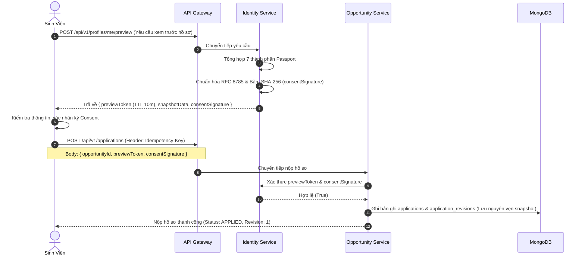
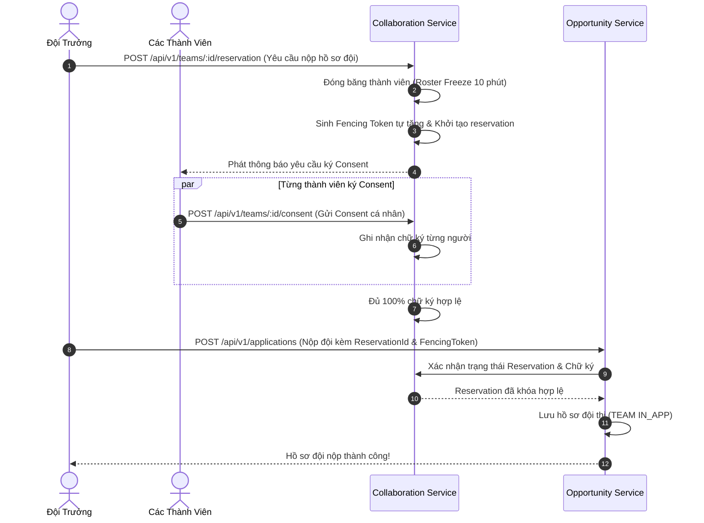

# 🌟 TỔNG QUAN TOÀN DIỆN DỰ ÁN SCHOLINK
### Nền Tảng Microservices & Android Native Hỗ Trợ Học Bổng, Cuộc Thi, Hồ Sơ Số Passport & Đội Thi

---

## 📑 MỤC LỤC TỔNG HỢP

1. [Giới Thiệu Chung & Mục Tiêu Dự Án](#1-giới-thiệu-chung--mục-tiêu-dự-án)
2. [Kiến Trúc Tổng Thể & Topology Hệ Thống](#2-kiến-trúc-tổng-thể--topology-hệ-thống)
3. [Chi Tiết 5 Nghiệp Vụ Microservices & API Gateway](#3-chi-tiết-5-nghiệp-vụ-microservices--api-gateway)
4. [Tầng Thư Viện Dùng Chung (Shared Kernel)](#4-tầng-thư-viện-dùng-chung-shared-kernel)
5. [Các Luồng Nghiệp Vụ Cốt Lõi (Core Workflows)](#5-các-luồng-nghiệp-vụ-cốt-lõi-core-workflows)
6. [Ứng Dụng Di Động Android Native (Kotlin Client)](#6-ứng-dụng-di-động-android-native-kotlin-client)
7. [Giao Diện Quản Trị Web Portal (Admin & Organizer)](#7-giao-diện-quản-trị-web-portal-admin--organizer)
8. [Các Quy Tắc Bất Biến Về Kiến Trúc & Bảo Mật](#8-các-quy-tắc-bất-biến-về-kiến-trúc--bảo-mật)
9. [Hạ Tầng Docker, Sao Lưu & Phục Hồi (Backup/Restore)](#9-hạ-tầng-docker-sao-lưu--phục-hồi-backuprestore)
10. [Hướng Dẫn Khởi Chạy & Vận Hành Nhanh (Quick Start)](#10-hướng-dẫn-khởi-chạy--vận-hành-nhanh-quick-start)
11. [Danh Mục Tài Liệu Kỹ Thuật Tham Chiếu](#11-danh-mục-tài-liệu-kỹ-thuật-tham-chiếu)

---

## 1. GIỚI THIỆU CHUNG & MỤC TIÊU DỰ ÁN

### 1.1. Scholink là gì?
**Scholink** là hệ sinh thái nền tảng số đa dịch vụ được thiết kế chuyên biệt cho sinh viên đại học và các tổ chức giáo dục, doanh nghiệp tài trợ. Dự án giải quyết các vấn đề nhức nhối trong hành trình phát triển học thuật của sinh viên:
- **Phân mảnh cơ hội:** Học bổng và cuộc thi thường nằm rải rác trên nhiều website, mạng xã hội, thiếu công cụ lọc chuyên sâu theo chuyên ngành, đối tượng, hạn chót.
- **Hồ sơ xin học bổng thiếu chuẩn hóa:** Sinh viên phải liên tục chuẩn bị lại CV, chứng chỉ, tệp minh chứng mỗi lần nộp hồ sơ mới.
- **Khó khăn lập đội thi (Team-Up):** Sinh viên khó tìm được đồng đội có kỹ năng bù trừ phù hợp (ví dụ: Designer ghép với Lập trình viên, Nhà kinh tế).
- **Thiếu tính minh bạch và bảo mật dữ liệu:** Rủi ro lộ lọt thông tin cá nhân khi nộp qua form mở; thiếu bằng chứng đồng thuận pháp lý khi nộp hồ sơ.

### 1.2. Mục Tiêu Cốt Lõi Của Hệ Thống
1. **Số hóa hồ sơ sinh viên (Digital Passport):** Chuẩn hóa hồ sơ năng lực 7 thành phần, tự động tính điểm hoàn thiện và bảo vệ dữ liệu với các mức phân quyền trường dữ liệu (`PRIVATE`, `TEAMMATES`, `PUBLIC`).
2. **Cơ chế nộp hồ sơ bất biến (Immutable Snapshot & Consent SHA-256):** Đảm bảo tính toàn vẹn và pháp lý của hồ sơ tại thời điểm nộp theo chuẩn RFC 8785.
3. **Quản lý Đội thi & Roster Freeze:** Cho phép tìm kiếm đồng đội, tuyển dụng thành viên nguyên tử chống race-condition, cơ chế khóa đội thi 10 phút trước nộp (`Submission Reservation`).
4. **Thẩm định hồ sơ trực quan (Organizer Kanban):** Cung cấp công cụ bảng Kanban thời gian thực với khóa lạc quan (Optimistic Locking) cho Ban tổ chức xét duyệt hồ sơ nhiều vòng.
5. **Đa nền tảng:** Hệ thống Backend Microservices mạnh mẽ kết nối liền mạch với ứng dụng di động Android Native viết bằng Kotlin Compose.

### 1.3. Căn Cứ Tiêu Chuẩn Kỹ Thuật
- Đặc tả yêu cầu kỹ thuật: **Scholink SRS v3.2** (ban hành ngày 17/10/2026).
- Phạm vi hoàn thiện: **CR-MVP-01** (Kế hoạch bàn giao MVP 5 tuần).
- Mô hình kiến trúc: **Clean Architecture / Hexagonal Architecture** kết hợp **Domain-Driven Design (DDD)** và **Database-per-Service**.

---

## 2. KIẾN TRÚC TỔNG THỂ & TOPOLOGY HỆ THỐNG

Dự án áp dụng mô hình phân tán **Microservices Monorepo** với 6 ứng dụng NestJS độc lập và 1 thư viện dùng chung:

```
                            [ ANDROID NATIVE KOTLIN CLIENT ]
                                        │ (HTTP REST / Port 3000)
                                        ▼
┌────────────────────────────────────────────────────────────────────────────────┐
│                       CỔNG TRUY CẬP: API GATEWAY (Port 3000)                    │
│  - Reverse Proxy Định Tuyến Thông Minh                                         │
│  - Tạo & Lan Truyền Correlation ID (X-Correlation-ID)                          │
│  - Phân Phối Tài Liệu OpenAPI / Swagger Aggregation                            │
│  - Web Portal UI: Admin Tổ Chức & Organizer Kanban Board (/portal)             │
└───────┬──────────────┬───────────────┬────────────────┬───────────────┬────────┘
        │              │               │                │               │
        │ :3001        │ :3002         │ :3003          │ :3004         │ :3005
        ▼              ▼               ▼                ▼               ▼
┌──────────────┐┌──────────────┐┌──────────────┐┌──────────────┐┌──────────────┐
│   IDENTITY   ││ OPPORTUNITY  ││COLLABORATION ││   BILLING    ││ NOTIFICATION │
│   SERVICE    ││   SERVICE    ││   SERVICE    ││   SERVICE    ││   SERVICE    │
│  (Port 3001) ││  (Port 3002) ││  (Port 3003) ││  (Port 3004) ││  (Port 3005) │
└───────┬──────┘└──────┬───────┘└──────┬───────┘└──────┬───────┘└──────┬───────┘
        │              │               │                │               │
        ▼              ▼               ▼                ▼               ▼
┌──────────────┐┌──────────────┐┌──────────────┐┌──────────────┐┌──────────────┐
│  Database:   ││  Database:   ││  Database:   ││  Database:   ││  Database:   │
│   scholink_  ││   scholink_  ││   scholink_  ││   scholink_  ││   scholink_  │
│   identity   ││ opportunity  ││collaboration ││   billing    ││ notification │
└──────────────┘└──────────────┘└──────────────┘└──────────────┘└──────────────┘
  ══════════════════════════════════════════════════════════════════════════════
               HẠ TẦNG DÙNG CHUNG QUA DOCKER (docker-compose.yml):
   - MongoDB 7.0 Replica Set (rs0): Giao tác phân tán ACID Multi-Document
   - Redis 7.2: Phân tán Lock, Idempotency-Key, Cache bộ lọc
   - RabbitMQ 3.13: Event Bus giao tiếp bất đồng bộ xuyên Microservices
   - MinIO Object Storage: Lưu trữ tệp tin riêng tư S3 (Minh chứng, avatar)
   - EMQX 5.6: MQTT Broker đẩy tin nhắn realtime cho ứng dụng Android
```

---

## 3. CHI TIẾT 5 NGHIỆP VỤ MICROSERVICES & API GATEWAY

### 3.1. API Gateway (Port 3000)
- **Vị trí thư mục:** `backend/apps/gateway/`
- **Nhiệm vụ:**
  - Điểm tiếp nhận request duy nhất từ bên ngoài (Single Entrypoint).
  - Reverse Proxy định tuyến trong suốt dựa trên tiền tố URI (`/api/v1/*`).
  - Đính kèm và lan truyền `x-correlation-id` để dễ dàng truy vết log phân tán.
  - Tích hợp giao diện **Web Portal** (`/portal`) phục vụ người dùng quản trị không cần cài đặt thêm server frontend phụ.
- **Bảng ánh xạ định tuyến (Routing Rules):**
  - `/api/v1/auth/*`, `/api/v1/profiles/*`, `/api/v1/admin/organizations/*` ➔ `http://localhost:3001`
  - `/api/v1/opportunities/*`, `/api/v1/applications/*` ➔ `http://localhost:3002`
  - `/api/v1/teams/*`, `/api/v1/chats/*` ➔ `http://localhost:3003`
  - `/api/v1/wallets/*` ➔ `http://localhost:3004`
  - `/api/v1/notifications/*` ➔ `http://localhost:3005`

### 3.2. Identity Microservice (Port 3001 - DB: `scholink_identity`)
- **Vị trí thư mục:** `backend/apps/identity-service/`
- **Nhiệm vụ:**
  - **Quản lý danh tính:** Đăng ký tài khoản (Email, OTP 6 số), Đăng nhập JWT (Access Token 15 phút, Refresh Token lưu hash trong database với cơ chế xoay vòng `familyId`).
  - **Hồ sơ số Passport (7 thành phần):**
    1. Thông tin cá nhân (`personal`)
    2. Học vấn (`education`)
    3. Giải thưởng & Thành tích (`awards`)
    4. Kỹ năng chuyên môn (`skills`)
    5. Ngoại ngữ & Chứng chỉ (`languages`)
    6. Dự án tiêu biểu (`projects`)
    7. Hoạt động ngoại khóa (`activities`)
  - **Thuật toán tính điểm hoàn thiện:** Điểm hoàn thiện từ 0% đến 100% theo trọng số cấu hình SRS (`scoreVersion=1`).
  - **Bảo mật Consent & Preview:**
    - Cung cấp endpoint tạo bản xem trước (`Preview`) có TTL 10 phút.
    - Chuẩn hóa JSON snapshot hồ sơ theo **RFC 8785 (JSON Canonicalization Scheme)**.
    - Băm **SHA-256** tạo mã băm đồng thuận pháp lý (`consentSignature`).
  - **Quản lý Tổ chức & Organizer:** Tạo đơn vị tổ chức, cấp quyền cho tài khoản sinh viên thành đại diện ban tổ chức (`ORGANIZER_ADMIN`, `ORGANIZER_MEMBER`).

### 3.3. Opportunity Microservice (Port 3002 - DB: `scholink_opportunity`)
- **Vị trí thư mục:** `backend/apps/opportunity-service/`
- **Nhiệm vụ:**
  - **Danh mục cơ hội:** Quản lý đồng thời 2 loại: Học bổng (`SCHOLARSHIP`) và Cuộc thi (`COMPETITION`).
  - **Phân loại hình thức nộp:**
    - `IN_APP`: Nộp trực tiếp trên hệ thống Scholink bằng Passport số và bản chụp Snapshot.
    - `EXTERNAL`: Mở liên kết nguồn ngoài của đơn vị tổ chức và cho phép sinh viên tự đánh dấu trạng thái.
  - **Bộ lọc & Phân trang Cursor-Based:** Tìm kiếm kết hợp theo lĩnh vực, hạn nộp, giá trị, hình thức với con trỏ phân trang ổn định (`limit`, `nextCursor`).
  - **Quy trình Nộp Hồ Sơ Cá Nhân & Quản Lý Revision:**
    - Kiểm tra tính hợp lệ của Snapshot và Consent SHA-256 từ Identity Service.
    - Cho phép sinh viên rút hồ sơ (`WITHDRAWN`) khi còn trước thời hạn deadline.
    - Hỗ trợ nộp lại trên cùng một mã `Application` với cơ chế tăng số phiên bản `revision` (lưu vết lịch sử thay đổi `application_revisions`).
  - **Kanban API Thẩm Định Hồ Sơ:**
    - Cung cấp API cập nhật trạng thái hồ sơ nhiều giai đoạn: `APPLIED` ➔ `REVIEWING` ➔ `SHORTLISTED` ➔ `INTERVIEW` ➔ `ACCEPTED` / `REJECTED`.
    - Bảo vệ chống ghi đè đồng thời bằng kiểm tra phiên bản `expectedVersion`.

### 3.4. Collaboration Microservice (Port 3003 - DB: `scholink_collaboration`)
- **Vị trí thư mục:** `backend/apps/collaboration-service/`
- **Nhiệm vụ:**
  - **Quản lý Đội thi (Team-Up):**
    - Tạo đội, tìm kiếm đồng đội theo kỹ năng và vai trò dự thi.
    - Gửi và duyệt lời mời tham gia (`JoinRequest`).
    - Cơ chế kiểm soát slot thành viên nguyên tử: Đảm bảo chỉ số thành viên không vượt quá số lượng tối đa (`maxMembers`) và sử dụng unique index `active_memberships` để chống race condition khi 2 người cùng nhận slot cuối.
  - **Khóa Nộp Hồ Sơ Đội (Roster Freeze & Submission Reservation):**
    - Đội trưởng tạo yêu cầu nộp hồ sơ đội (`TEAM IN_APP`).
    - Hệ thống đóng băng danh sách thành viên trong 10 phút (`Roster Freeze`).
    - Khởi tạo `submission_reservations` với **Fencing Token** tự tăng.
    - Thu thập đủ Consent SHA-256 hợp lệ của toàn bộ thành viên chính thức.
    - Cơ chế **Reservation Worker** tự động giải phóng khóa (Rollback) nếu quá 10 phút mà đội chưa hoàn tất nộp hồ sơ.
  - **Phòng Chat Đội Thi & Nhắn Tin Thời Gian Thực:**
    - Quản lý phòng chat nhóm đội thi (`ChatRoom`).
    - Bộ đếm tin nhắn tăng dần tuyệt đối (**Monotonic Sequence Number - `seq`**) cho từng phòng chat.
    - Hỗ trợ Outbox Pattern đẩy tin sang EMQX MQTT.
    - Chống gửi trùng tin nhắn bằng `clientMsgId`.
    - Hỗ trợ đồng bộ bù tin nhắn sau khi mất mạng bằng truy vấn `afterSeq`.

### 3.5. Billing Microservice (Port 3004 - DB: `scholink_billing`)
- **Vị trí thư mục:** `backend/apps/billing-service/`
- **Nhiệm vụ:**
  - **Ví điện tử nội bộ:** Quản lý số dư tiền số nguyên VND (`balance`), không dùng số thực để tránh sai số thập phân.
  - **Quy tắc số dư bất biến:** Luôn duy trì `balance >= held >= 0` (Số dư khả dụng = `balance - held`).
  - **Quy trình Giữ & Thu Hồi Tiền (Hold/Capture):** Đóng băng số tiền thanh toán khi người dùng thực hiện giao dịch, tự động giải phóng (Release) nếu hủy hoặc trừ dứt điểm (Capture) khi hoàn tất mua dịch vụ.
  - **Nạp tiền Sandbox & Mua gói SKU:** Hỗ trợ nạp tiền thử nghiệm và mua các gói dịch vụ thành viên Plus, Ghim tin nổi bật Boost.

### 3.6. Notification Microservice (Port 3005 - DB: `scholink_notification`)
- **Vị trí thư mục:** `backend/apps/notification-service/`
- **Nhiệm vụ:**
  - Hộp thư thông báo trong ứng dụng (In-app notification).
  - Tự động quét và nhắc nhở thời hạn nộp hồ sơ học bổng/cuộc thi theo các mốc `T-7`, `T-3`, `T-1` ngày trước khi đóng đơn.
  - Áp dụng quy tắc giờ yên lặng (Quiet Hours): Không đẩy thông báo làm phiền người dùng trong khoảng từ `22:00` đến `07:00` sáng hôm sau.
  - Đẩy thông báo thời gian thực đến điện thoại người dùng qua giao thức MQTT.

---

## 4. TẦNG THƯ VIỆN DÙNG CHUNG (SHARED KERNEL)

Thư viện chia sẻ [`backend/libs/shared/`](file:///c:/Users/Administrator/Desktop/PROJECT/Scholink/backend/libs/shared) tuân thủ chặt chẽ nguyên tắc **Hexagonal Architecture**:

1. **Domain Primitives (`libs/shared/src/domain/`):**
   - Lớp thực thể cơ sở `Entity<T>` và gốc tổng hợp `AggregateRoot<T>`.
   - Đối tượng giá trị `ValueObject<T>`.
   - Kết quả xử lý chuẩn hóa `Result<T>` (mô hình Railway-Oriented Programming).
   - Hệ thống mã lỗi hợp nhất `ErrorCode` và biệt lệ miền `DomainException`.
2. **Application Helpers (`libs/shared/src/application/`):**
   - `PaginationHelper`: Hỗ trợ mã hóa và giải mã con trỏ (Base64 Cursor Pagination) đảm bảo hiệu năng cao với tập dữ liệu lớn.
3. **Infrastructure & Cross-Cutting Concerns (`libs/shared/src/infrastructure/`):**
   - `ZodValidationPipe`: Xác thực dữ liệu đầu vào (DTO) 100% bằng thư viện Zod, loại bỏ hoàn toàn các payload không hợp lệ trước khi chạm vào tầng Use Case.
   - `GlobalExceptionFilter`: Bắt toàn bộ lỗi và chuẩn hóa cấu trúc phản hồi JSON:
     ```json
     {
       "error": {
         "code": "VALIDATION_FAILED",
         "message": "Dữ liệu không hợp lệ",
         "details": [...],
         "correlationId": "550e8400-e29b-41d4-a716-446655440000"
       }
     }
     ```
   - `JwtAuthGuard` & `RolesGuard`: Xác thực Access Token và kiểm tra vai trò người dùng (`STUDENT`, `ORGANIZER`, `ADMIN`).
   - `IdempotencyGuard`: Kiểm tra và chặn các thao tác lặp lại trùng lặp bằng cách lưu khóa trên Redis.
   - `CryptoService`: Cung cấp hàm băm chuẩn hóa JSON Canonicalization RFC 8785 và SHA-256.

---

## 5. CÁC LUỒNG NGHIỆP VỤ CỐT LÕI (CORE WORKFLOWS)

### 5.1. Luồng Nộp Hồ Sơ Cá Nhân Bất Biến (Workflow WF05 & FR-APP-01..03)



### 5.2. Luồng Nộp Hồ Sơ Đội Thi & Roster Freeze (Workflow WF06 & FR-APP-05, F33)



---

## 6. ỨNG DỤNG DI ĐỘNG ANDROID NATIVE (KOTLIN CLIENT)

Mã nguồn nằm trong thư mục [`android/`](file:///c:/Users/Administrator/Desktop/PROJECT/Scholink/android):

### 6.1. Kiến Trúc Kỹ Thuật Mobile
- **Ngôn ngữ:** Kotlin 2.0+ Native.
- **Tầng hiển thị (UI):** 100% Jetpack Compose với phong cách thiết kế Material3 hiện đại.
- **Kiến trúc phân tầng:** Clean Architecture (Presentation ➔ Domain ➔ Data) kết hợp mẫu thiết kế MVVM:
  - `ViewModel` quản lý trạng thái luồng dữ liệu một chiều (`StateFlow<UiState>`).
  - Xử lý triệt để 4 trạng thái giao diện: **Loading**, **Success**, **Error**, và **Empty/Offline**.

### 6.2. Các Giải Pháp An Ninh & Ổn Định
- **Lưu trữ bảo mật bằng Keystore:** Toàn bộ Access Token và Refresh Token được lưu trữ bằng `EncryptedSharedPreferences` với khóa mã hóa phần cứng **Android Keystore (AES-256-GCM)**, không lưu plain-text.
- **Tự động gắn Idempotency-Key:** Cung cấp `IdempotencyInterceptor` tại tầng OkHttp tự động chèn mã UUID duy nhất cho mọi request thay đổi dữ liệu (`POST`, `PUT`, `PATCH`), tránh gửi lặp khi mạng chập chờn.
- **Bộ nhớ đệm ngoại tuyến (Offline Caching với Room):** Danh mục cơ hội đã tải được lưu tự động vào Room SQLite Database. Khi ngắt mạng, người dùng vẫn có thể xem lại học bổng đã lưu kèm chỉ báo ngoại tuyến trực quan.
- **Kết nối Realtime qua MQTT:** Tích hợp thư viện Paho MQTT Client lắng nghe các Topic thông báo và phòng chat qua EMQX Broker.

---

## 7. GIAO DIỆN QUẢN TRỊ WEB PORTAL (ADMIN & ORGANIZER)

Được nhúng trực tiếp tại API Gateway và phục vụ qua đường dẫn:  
👉 **`http://localhost:3000/portal`**

### 7.1. Phân Hệ Web Admin Tổ Chức (Quản Trị Hệ Thống)
- Cho phép Quản trị viên hệ thống (Admin) tạo mới và quản lý các Đơn vị tổ chức (Trường học, Quỹ học bổng, Doanh nghiệp tài trợ).
- Cung cấp tính năng tìm kiếm sinh viên theo địa chỉ email và gán quyền trở thành **Organizer** (`ORGANIZER_ADMIN` hoặc `ORGANIZER_MEMBER`) để đại diện cho tổ chức đó.

### 7.2. Phân Hệ Web Organizer Kanban (Thẩm Định Hồ Sơ Ứng Tuyển)
- Giao diện trực quan dạng bảng Kanban 6 cột giúp Ban tổ chức lọc và kéo/chuyển trạng thái ứng viên:
  1. `Mới nộp (APPLIED)`
  2. `Đang thẩm định (REVIEWING)`
  3. `Vào vòng trong (SHORTLISTED)`
  4. `Phỏng vấn (INTERVIEW)`
  5. `Trúng tuyển (ACCEPTED)`
  6. `Từ chối (REJECTED)`
- Áp dụng cơ chế **Optimistic Locking**: Khi giám khảo chuyển trạng thái hồ sơ, hệ thống bắt buộc gửi kèm tham số `expectedVersion` để bảo vệ dữ liệu không bị ghi đè lẫn nhau khi có nhiều giám khảo cùng chấm điểm tại một thời điểm.

---

## 8. CÁC QUY TẮC BẤT BIẾN VỀ KIẾN TRÚC & BẢO MẬT

Tất cả các thành viên tham gia phát triển dự án bắt buộc phải tuân thủ nghiêm ngặt 5 nguyên tắc bất biến:

1. **Cô Lập Cơ Sở Dữ Liệu (Database Isolation):**
   - Mỗi microservice sở hữu cơ sở dữ liệu logic hoàn toàn riêng biệt.
   - **Nghiêm cấm tuyệt đối** việc service này kết nối hoặc thực hiện câu lệnh truy vấn trực tiếp vào database/collection của service khác.
2. **Định Danh Zero-Trust (Server-Verified Identity):**
   - Toàn bộ thông tin định danh (`userId`, `role`, `organizationId`) phải được trích xuất từ JWT Token đã được xác minh tại tầng Server.
   - Không tin tưởng bất kỳ thông tin nào do client tự khai báo trong body payload (như `ownerId`, `studentId`, `isAdmin`).
3. **Tính Toàn Vẹn & Bất Biến Của Hồ Sơ Nộp (RFC 8785 & Immutable Snapshot):**
   - Hồ sơ khi nộp sẽ được chụp snapshot tại thời điểm ký Consent và lưu nguyên vẹn vào `application_revisions`. Mọi thao tác chỉnh sửa Passport sau đó chỉ có tác dụng với các lần nộp sau, không làm thay đổi hồ sơ ban tổ chức đã nhận.
4. **Chống Ghi Trùng Bằng Idempotency-Key & Unique Indexes:**
   - Mọi thao tác nộp hồ sơ, duyệt thành viên, giao dịch tiền tệ bắt buộc có cơ chế Idempotent dựa trên Redis và ràng buộc chỉ mục duy nhất (Unique Index) dưới database để chống tình trạng nhấn đúp hoặc mạng lag gửi trùng.
5. **Lưu Trữ Tệp Riêng Tư An Toàn (MinIO Private Buckets):**
   - Toàn bộ chứng chỉ, tệp đính kèm học bổng được lưu trong MinIO Bucket ở chế độ riêng tư (Private). Chỉ cho phép đính kèm tệp thuộc quyền sở hữu của chính người dùng và tệp đã ở trạng thái sẵn sàng (`READY`).

---

## 9. HẠ TẦNG DOCKER, SAO LƯU & PHỤC HỒI (BACKUP/RESTORE)

### 9.1. Các Thành Phần Hạ Tầng ([`docker-compose.yml`](file:///c:/Users/Administrator/Desktop/PROJECT/Scholink/docker-compose.yml))
Hạ tầng dùng chung được đóng gói hoàn chỉnh bằng Docker:
- **MongoDB 7.0 Replica Set (`rs0`):** Hỗ trợ tính năng Multi-Document ACID Transactions xuyên suốt các use-case nghiệp vụ phức tạp.
- **Redis 7.2-alpine:** Lưu trữ phân tán cho Idempotency Lock, Token Blacklist và bộ đệm cache.
- **RabbitMQ 3.13-management:** Hàng đợi thông điệp (Event Bus) phục vụ Outbox Pattern.
- **MinIO S3 Object Storage:** Lưu trữ tệp minh chứng và tài liệu sinh viên.
- **EMQX 5.6 Broker:** Cầu nối giao tiếp thời gian thực MQTT cho thiết bị di động.

### 9.2. Kịch Bản Sao Lưu & Phục Hồi Tự Động (Backup & Restore)
Dự án được trang bị sẵn 2 công cụ vận hành tiêu chuẩn:
- **Sao lưu toàn diện 5 cơ sở dữ liệu:**
  ```bash
  cd backend
  pnpm run backup
  ```
  *Kết quả:* Tạo ra thư mục sao lưu có dấu thời gian dạng `backend/backups/backup_YYYYMMDD_HHMMSS/` chứa đầy đủ 5 tệp JSON dữ liệu của từng service độc lập.
- **Phục hồi cơ sở dữ liệu:**
  ```bash
  cd backend
  pnpm run restore
  # Hoặc chỉ định rõ thư mục phục hồi:
  pnpm run restore -- backend/backups/backup_20261031_120000
  ```

---

## 10. HƯỚNG DẪN KHỞI CHẠY & VẬN HÀNH NHANH (QUICK START)

### Bước 1: Yêu cầu môi trường cài đặt
- **Node.js:** Phiên bản `v20.x` hoặc `v22.x` (LTS khuyến nghị).
- **Trình quản lý gói:** `pnpm` (khuyến khích) hoặc `npm`.
- **Docker & Docker Compose:** Đã cài đặt và đang chạy nền.
- **Android Studio (Ladybug / Koala):** Dành cho việc chạy và build ứng dụng di động.

### Bước 2: Khởi chạy hạ tầng Docker
Mở terminal tại thư mục gốc của dự án (`Scholink/`):
```bash
docker compose up -d
```
*Kiểm tra nhanh các cổng dịch vụ:*
- MongoDB: `localhost:27017`
- Redis: `localhost:6379`
- RabbitMQ Web UI: `http://localhost:15672` (Tài khoản: `guest` / `guest`)
- MinIO Web Console: `http://localhost:9001` (Tài khoản: `scholink_minio_admin` / `scholink_minio_password`)
- EMQX Dashboard: `http://localhost:18083` (Tài khoản: `admin` / `public`)

### Bước 3: Cài đặt Dependencies & Khởi tạo Dữ liệu Mẫu (Seed)
```bash
# Di chuyển vào thư mục backend
cd backend

# Cài đặt toàn bộ thư viện cho Monorepo
pnpm install

# Khởi tạo dữ liệu mẫu kiểm thử
pnpm run seed
```

**Danh sách tài khoản kiểm thử mặc định sau khi Seed:**
| Vai trò | Email đăng nhập | Mật khẩu mặc định | Dữ liệu kèm theo |
|---|---|---|---|
| **ADMIN** | `admin@scholink.edu.vn` | `ScholinkAdmin@2026` | Toàn quyền quản trị hệ thống và tổ chức |
| **ORGANIZER** | `organizer@scholink.edu.vn` | `Organizer@2026` | Đại diện Ban tổ chức Viện Nghiên cứu VinAI |
| **STUDENT** | `student@scholink.edu.vn` | `Student@2026` | Passport hoàn thiện 100%, ví có sẵn 500,000 VND |

### Bước 4: Khởi động các Microservices
Mở từng cửa sổ terminal riêng biệt trong thư mục `backend/` để khởi chạy các dịch vụ:
```bash
cd backend
pnpm run start:gateway        # API Gateway & Web Portal (Port 3000)
pnpm run start:identity       # Identity Microservice (Port 3001)
pnpm run start:opportunity    # Opportunity Microservice (Port 3002)
pnpm run start:collaboration  # Collaboration Microservice (Port 3003)
pnpm run start:billing        # Billing Microservice (Port 3004)
pnpm run start:notification   # Notification Microservice (Port 3005)
```

### Bước 5: Truy cập tài liệu API & Giao diện quản trị
- **Scholink Web Portal:** `http://localhost:3000/portal`
- **Swagger API Gateway (Tổng quan):** `http://localhost:3000/docs`
- **Swagger Identity Service:** `http://localhost:3001/docs`
- **Swagger Opportunity Service:** `http://localhost:3002/docs`
- **Swagger Collaboration Service:** `http://localhost:3003/docs`
- **Swagger Billing Service:** `http://localhost:3004/docs`
- **Swagger Notification Service:** `http://localhost:3005/docs`

---

## 11. DANH MỤC TÀI LIỆU KỸ THUẬT THAM CHIẾU

Toàn bộ các tài liệu chuyên sâu được lưu trữ có cấu trúc trong thư mục [`docs/`](file:///c:/Users/Administrator/Desktop/PROJECT/Scholink/docs):

1. 📑 **[Scholink SRS v3.2 (52 trang / 220KB)](file:///c:/Users/Administrator/Desktop/PROJECT/Scholink/docs/Scholink_Tai_Lieu_Phat_Trien_Team.md):** Bản đặc tả đầy đủ nhất về mọi ca sử dụng, thực thể CSDL, mã lỗi và quy tắc nghiệp vụ.
2. 📘 **[Sổ Tay Hướng Dẫn Phát Triển Microservices](file:///c:/Users/Administrator/Desktop/PROJECT/Scholink/docs/HUONG_DAN_PHAT_TRIEN.md):** Quy chuẩn kiến trúc, quy tắc phân tầng, cấu trúc code Clean Architecture và hướng dẫn phát triển code mới.
3. 📕 **[Runbook Vận Hành Demo](file:///c:/Users/Administrator/Desktop/PROJECT/Scholink/docs/RUNBOOK_VAN_HANH_DEMO_TV3.md):** Sổ tay kịch bản kiểm thử trực quan trên Web Portal (Admin Tổ chức, Kanban Thẩm định, Roster Freeze, Backup/Restore).
4. 📱 **[Sổ Tay Phát Triển Android Native](file:///c:/Users/Administrator/Desktop/PROJECT/Scholink/docs/HUONG_DAN_ANDROID.md):** Hướng dẫn chi tiết về Jetpack Compose, Room Cache, Keystore Token và cấu hình chạy trên thiết bị di động.
5. 🛡️ **[Sổ Tay Kiểm Thử Toàn Diện](file:///c:/Users/Administrator/Desktop/PROJECT/Scholink/docs/HUONG_DAN_KIEM_THU_TOAN_DIEN.md):** Quy trình và chiến lược thực hiện Unit Test, Integration Test, Load Test và OWASP Security.
6. 🎯 **[Kiểm Soát Phạm Vi MVP 5 Tuần](file:///c:/Users/Administrator/Desktop/PROJECT/Scholink/docs/MVP_SCOPE_CR.md):** Ranh giới các tính năng trong bản phát hành R1 (MVP) và các tính năng hoãn sang R2/R3.

---
*Tài liệu tổng quan hệ thống Scholink Platform 2026. Bản cập nhật mới nhất theo chuẩn SRS v3.2.*
