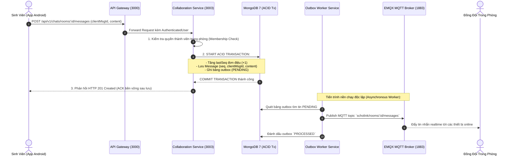

# Chức Năng 1: Chat Nhóm Đội Thi & MQTT Realtime Reconnect (SCHOL-26)

> **Mã công việc:** SCHOL-26 — [S2][Phú][BE] Chat nhóm và MQTT reconnect  
> **Người thực hiện:** Bùi Đặng Vĩnh Phú (Backend Lead)  
> **Microservice đảm nhiệm:** `apps/collaboration-service` (Port 3003)  
> **Hạ tầng phối hợp:** EMQX MQTT Broker (Port 1883), MongoDB 7 Replica Set (Port 27017), Notification Service (Port 3005)

---

## 1. Mục Tiêu Kỹ Thuật & Bài Toán Cần Giải Quyết

Trong các ứng dụng thi đấu học thuật theo nhóm, giao tiếp thời gian thực là tính năng sống còn nhưng đối mặt với các thách thức kỹ thuật phân tán:
1. **Mạng di động chập chờn (Flaky Mobile Network)**: Sinh viên di chuyển qua vùng sóng yếu, ứng dụng tự động kết nối lại (reconnect) và gửi lại gói tin cũ gây trùng lặp tin nhắn.
2. **Xung đột số thứ tự tin nhắn (Message Ordering & Concurrency)**: Hai thành viên cùng bấm gửi tin nhắn tại cùng một thời điểm microsecond.
3. **Mất mát dữ liệu khi Message Broker gặp sự cố**: Nếu lấy MQTT làm nguồn dữ liệu chính, khi broker reboot hoặc tràn hàng đợi, tin nhắn sẽ bị biến mất vĩnh viễn.
4. **Rò rỉ quyền hạn (Privilege Leak)**: Thành viên sau khi bị kick hoặc tự rời khỏi đội vẫn lén lút subscribe topic MQTT để nghe trộm tin mật chiến thuật.

---

## 2. Kiến Trúc Giải Pháp & Sơ Đồ Gọi Dịch Vụ



---

## 3. Lược Đồ Dữ Liệu & Ràng Buộc Độc Nhất (Schema & Unique Constraints)

Được định nghĩa tại [`chat.schema.ts`](file:///C:/Users/Administrator/Desktop/PROJECT/Scholink/backend/apps/collaboration-service/src/infrastructure/persistence/chat.schema.ts) và [`chat.entity.ts`](file:///C:/Users/Administrator/Desktop/PROJECT/Scholink/backend/apps/collaboration-service/src/domain/chat.entity.ts):

### 3.1. Bảng `chat_rooms`
- `id`: Định danh phòng chat dạng `room_<uuid>`.
- `contextType`: `'TEAM'` (hoặc `'DIRECT'`).
- `contextId`: ID của đội thi (`teamId`).
- `memberIds`: Mảng danh sách userId thành viên hiện tại trong phòng.
- `lastSeq`: Số thứ tự tin nhắn cao nhất hiện tại (khởi tạo = 0, tăng đơn điệu).

### 3.2. Bảng `messages`
- `id`: ID tin nhắn (`msg_<uuid>`).
- `roomId`: Khóa ngoại tham chiếu `chat_rooms`.
- `senderId`: ID người gửi.
- `seq`: Số thứ tự tin nhắn trong phòng (1, 2, 3...).
- `clientMsgId`: Mã UUID do client sinh ra để khử trùng lặp.
- `content`: Nội dung tin nhắn văn bản đã làm sạch XSS.
- `readBy`: Danh sách người dùng đã đọc.

> [!IMPORTANT]
> **2 Chỉ mục duy nhất (Unique Compound Indexes) cốt lõi:**
> 1. `CREATE UNIQUE INDEX (roomId, senderId, clientMsgId)`: Đảm bảo khi client retry gửi lại do rớt mạng, cơ sở dữ liệu sẽ chặn đứng việc tạo 2 tin nhắn giống nhau (Idempotent Delivery).
> 2. `CREATE UNIQUE INDEX (roomId, seq)`: Bảo đảm tính đơn điệu tuyệt đối, không bao giờ xảy ra tình trạng 2 tin nhắn cùng phòng có chung số thứ tự `seq`.

### 3.3. Bảng `outbox`
- `aggregateType`: `'CHAT_MESSAGE'`
- `aggregateId`: `roomId`
- `payload`: Toàn bộ nội dung tin nhắn cần phát qua broker.
- `status`: `'PENDING' | 'PROCESSED' | 'FAILED'`

---

## 4. Chi Tiết Thực Thi Code (Code Walkthrough)

### 4.1. Gửi tin nhắn ACID và ACK sau lưu bền vững
Trong [`chat.use-case.ts`](file:///C:/Users/Administrator/Desktop/PROJECT/Scholink/backend/apps/collaboration-service/src/application/use-cases/chat.use-case.ts):

```typescript
async sendMessage(dto: SendMessageDto): Promise<MessageResponseDto> {
  const room = await this.chatRepo.findRoomById(dto.roomId);
  if (!room) {
    throw DomainException.notFound('Phòng chat');
  }

  // 1. Kiểm tra tư cách thành viên trong phòng chat
  if (!room.isMember(dto.senderId)) {
    throw DomainException.forbidden('Bạn không phải là thành viên của phòng chat này');
  }

  // 2. Kiểm tra trùng lặp Idempotency qua clientMsgId
  if (dto.clientMsgId) {
    const existing = await this.chatRepo.findMessageByClientMsgId(
      dto.roomId,
      dto.senderId,
      dto.clientMsgId,
    );
    if (existing) {
      return this.toResponse(existing); // Trả về tin nhắn cũ mà không tăng seq
    }
  }

  // 3. Tăng sequence đơn điệu và tạo Message Entity
  const nextSeq = room.props.lastSeq + 1;
  const message = Message.create({
    id: `msg_${crypto.randomUUID()}`,
    roomId: room.id,
    senderId: dto.senderId,
    seq: nextSeq,
    clientMsgId: dto.clientMsgId,
    content: dto.content,
  });

  // 4. Lưu Message + Update room.lastSeq + Ghi Outbox trong cùng Transaction
  const updatedRoom = room.updateLastMessage(message);
  await this.chatRepo.saveMessageWithTransaction(message, {
    roomId: room.id,
    messageId: message.id,
    senderId: message.senderId,
    seq: message.seq,
    content: message.content,
    createdAt: message.createdAt.toISOString(),
  });
  await this.chatRepo.updateRoom(updatedRoom);

  return this.toResponse(message);
}
```

### 4.2. Read Cursor tăng đơn điệu qua toán tử `$max`
Để tránh việc client đọc chậm hoặc gửi gói tin cũ làm lùi vị trí đã đọc:

```typescript
async updateReadCursor(roomId: string, userId: string, seq: number): Promise<number> {
  // Sử dụng MongoDB $max operator: chỉ cập nhật nếu seq mới > cursor cũ
  return this.chatRepo.updateReadCursor(roomId, userId, seq);
}
```

### 4.3. EMQX Broker Authentication & ACL Webhook
Khi client kết nối MQTT hoặc gửi lệnh `SUBSCRIBE` / `PUBLISH`, EMQX gửi HTTP Webhook tới Collaboration Service:

```typescript
@Post('mqtt/acl')
async checkAcl(@Body() body: { username: string; topic: string; access: number }) {
  // Topic pattern: scholink/rooms/:roomId/messages
  const roomId = this.extractRoomIdFromTopic(body.topic);
  const room = await this.chatRepo.findRoomById(roomId);
  
  // Chỉ cho phép nếu user nằm trong room.memberIds
  if (room && room.isMember(body.username)) {
    return { result: 'allow' };
  }
  return { result: 'deny' }; // Thu hồi quyền lập tức nếu đã rời đội
}
```

### 4.4. Cơ chế Outbox Worker & Tái phát lại an toàn khi Broker Crash
Trong [`chat-outbox-worker.service.ts`](file:///C:/Users/Administrator/Desktop/PROJECT/Scholink/backend/apps/collaboration-service/src/infrastructure/workers/chat-outbox-worker.service.ts):
- Định kỳ quét các bản ghi `PENDING` trong bảng `outbox`.
- Phát lên MQTT topic `scholink/rooms/${roomId}/messages`.
- Nếu EMQX Broker bị tắt, worker bắt lỗi, giữ nguyên trạng thái `PENDING`, tăng `retryCount` với thuật toán Exponential Backoff.
- Khi Broker online trở lại, worker phát bù theo đúng thứ tự `seq`.
- Phía Client nhận tin sử dụng `(roomId, seq)` để sắp xếp và bỏ qua các gói tin trùng lặp nếu có phát lại.

---

## 5. Bằng Chứng Kiểm Thử Đạt Chuẩn (Verification Test Suite)

Tệp kiểm thử phụ trách: [`chat-schol26.spec.ts`](file:///C:/Users/Administrator/Desktop/PROJECT/Scholink/backend/apps/collaboration-service/src/chat-schol26.spec.ts).

### Kịch bản 1: Gửi tin nhắn đồng thời không trùng Sequence
- **Kịch bản:** Mô phỏng 10 requests gửi tin cùng một mili-giây từ nhiều thành viên trong đội.
- **Kết quả:** Hệ thống cấp phát chính xác 10 số `seq` liên tiếp từ 1 đến 10, không có bất kỳ số nào bị trùng lặp hoặc bỏ sót.

### Kịch bản 2: Khử trùng lặp qua ClientMsgId
- **Kịch bản:** Client gửi cùng một `clientMsgId: "cmsg_uuid_001"` 3 lần liên tiếp do timeout giả lập.
- **Kết quả:** Chỉ có 1 bản ghi Message được lưu trong MongoDB; 2 request sau nhận lại đúng tin nhắn đầu tiên với mã `200 OK`, không làm tăng `lastSeq`.

### Kịch bản 3: Crash Recovery (Broker sập ngay sau commit DB)
- **Kịch bản:** Cơ sở dữ liệu ghi nhận thành công, nhưng ngắt kết nối MQTT trước khi phát tin.
- **Kết quả:** Client vẫn nhận được mã ACK 201 Created bền vững. Tin nhắn được lưu trong Outbox. Sau khi kết nối Broker phục hồi, worker phát lại thành công.

### Kịch bản 4: Thu hồi quyền chat khi rời đội
- **Kịch bản:** Thành viên A bị xóa khỏi đội hoặc tự rời đội.
- **Kết quả:** Thành viên A cố tình gửi tin `POST /messages` nhận về `403 Forbidden`. Thử truy vấn `GET /messages` nhận về `403 Forbidden`. EMQX ACL Webhook lập tức từ chối quyền `SUBSCRIBE`.

---

## 6. Tóm Tắt Trả Lời Vấn Đáp Nhanh Cho Phú

- **Hỏi:** *Tại sao không publish trực tiếp lên MQTT Broker ngay khi nhận request gửi tin?*
  - **Đáp:** Nếu publish trước hoặc đồng thời mà không qua Outbox: khi MongoDB lưu thất bại (rollback), client bên ngoài đã nhận được tin nhắn rác (Ghost Message); hoặc ngược lại khi DB lưu thành công mà Broker sập thì tin nhắn bị mất. Sử dụng **Transactional Outbox** đảm bảo tính nhất quán cuối cùng (**Eventual Consistency**) và cam kết **At-least-once delivery**.
- **Hỏi:** *Làm sao giải quyết việc tin nhắn phát lại bị trùng lặp ở client?*
  - **Đáp:** Phía Client lưu trữ `lastSeenSeq` của từng phòng. Mọi tin nhắn có `seq <= lastSeenSeq` hoặc trùng `clientMsgId` sẽ tự động bị loại bỏ ở tầng Presentation của mobile app.
