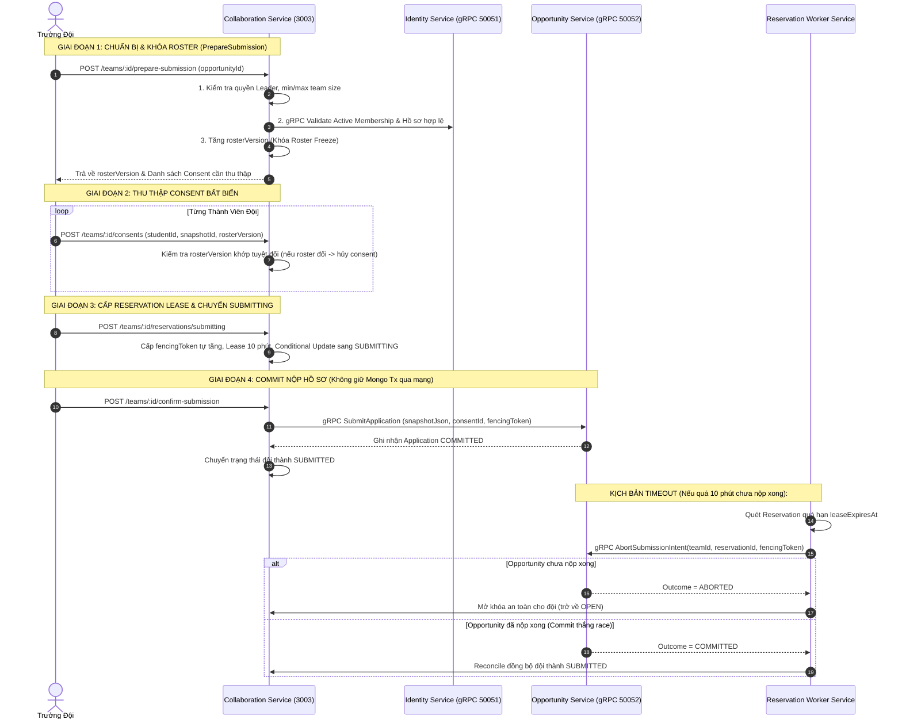

# Chức Năng 2: Consent Đội, Roster Freeze & Khóa Reservation Nộp Hồ Sơ (SCHOL-20)

> **Mã công việc:** SCHOL-20 — [S3][Phú][BE] Consent đội, roster freeze và reservation  
> **Người thực hiện:** Bùi Đặng Vĩnh Phú (Backend Lead)  
> **Microservice đảm nhiệm:** `apps/collaboration-service` (Port 3003) & `apps/opportunity-service` (Port 3002)  
> **Hạ tầng phối hợp:** MongoDB 7 Replica Set, gRPC Binary Stream (Port 50051 & 50052), Background Timeout Worker

---

## 1. Mục Tiêu Kỹ Thuật & Thách Thức Nghiệp Vụ

Trong quy trình nộp hồ sơ thi đấu đồng đội (Hackathon, ICPC, SV-NCKH), quy trình nộp hồ sơ là luồng phân tán phức tạp nhất với nhiều rủi ro tranh chấp dữ liệu (Race Condition):
1. **Hiện tượng Rút/Đổi thành viên phút chót (Roster Mutation Race)**: Trưởng đội đang nhấn nút nộp hồ sơ thì một thành viên bất ngờ rút khỏi đội hoặc thay đổi CV, dẫn tới hồ sơ nộp sai lệch danh sách thực tế.
2. **Nộp trùng thành viên (Double Booking / Cross-Team Participation)**: Một sinh viên tham gia 2 đội khác nhau; cả 2 đội cùng nộp hồ sơ cho cùng 1 cuộc thi.
3. **Tranh chấp giữa Timeout Worker và Client Commit (Commit vs Abort Race)**: Khi gần hết hạn 10 phút, Client vừa gửi lệnh nộp hồ sơ thì tiến trình Worker Timeout cũng vừa kích hoạt lệnh hủy.
4. **Tắc nghẽn tài nguyên CSDL (DB Lock Contention)**: Nếu giữ Transaction MongoDB mở trong lúc gọi mạng gRPC sang dịch vụ khác, cơ sở dữ liệu sẽ bị cạn kiệt connection pool khi có độ trễ mạng.

---

## 2. Kiến Trúc Giải Pháp & Sơ Đồ Giao Tiếp Phân Tán



---

## 3. Các Trụ Cột Kỹ Thuật Cốt Lõi (7 Tiêu Chí SCHOL-20)

### 3.1. Roster Versioning & Invalidation
- Mỗi đội có một thuộc tính `rosterVersion` (bắt đầu từ 1).
- Mỗi khi có bất kỳ sự thay đổi nào về nhân sự (thành viên vào, thành viên ra, đổi trưởng đội), `rosterVersion` tự động tăng lên (+1).
- Mọi Consent ký số của thành viên được gắn chặt với bộ ba: `(studentId, profileVersion, rosterVersion)`.
- **Hệ quả bảo mật:** Nếu Trưởng đội đã thu thập đủ 3/3 consent, nhưng sau đó có 1 thành viên tự ý rời đội hoặc đổi CV, `rosterVersion` tăng lên ➔ **Toàn bộ 3 consent trước đó lập tức bị vô hiệu hóa**. Đội bắt buộc phải xin lại consent từ đầu, loại bỏ hoàn toàn khả năng nộp sai lệch danh sách thành viên.

### 3.2. Cập Nhật Có Điều Kiện (Conditional Update) & Fencing Token
Để tránh tình trạng 2 tiến trình cùng chuyển trạng thái đội thi:
```typescript
// Chỉ chuyển sang SUBMITTING nếu trạng thái hiện tại là OPEN/DRAFT và version khớp
const updated = await this.teamRepo.updateTeamStatusConditional(
  teamId,
  'OPEN',        // Expected Status
  'SUBMITTING',  // New Status
  {
    reservationId: reservation.id,
    leaseExpiresAt: new Date(Date.now() + 10 * 60 * 1000), // Lease 10 phút
    fencingToken: nextFencingToken,
    expectedVersion: team.version,
  }
);
if (!updated) {
  throw DomainException.conflict(ErrorCode.STATE_CONFLICT, 'Đội đang trong phiên nộp hồ sơ khác');
}
```
- `fencingToken`: Số nguyên tự tăng đơn điệu mỗi phiên giữ chỗ. Bất kỳ request nào mang `fencingToken` cũ hơn số hiện tại đều bị từ chối (Stale Write Rejection).

### 3.3. Giải Phóng Transaction Khi Gọi Network (Non-Blocking gRPC Calls)
- **Quy tắc vàng:** Không bao giờ giữ MongoDB Client Session / Transaction mở khi thực hiện cuộc gọi qua mạng gRPC (`IdentityService` hoặc `OpportunityService`).
- **Thực thi:**
  1. Kiểm tra điều kiện và đóng transaction cục bộ.
  2. Thực hiện gRPC binary stream qua mạng.
  3. Mở transaction mới để lưu kết quả trả về.

### 3.4. Phân Xử Tranh Chấp Race Condition Giữa Timeout Worker & Client Commit
Đây là thuật toán phức tạp nhất được giải quyết tại `Opportunity Service` ([`application.use-case.ts`](file:///C:/Users/Administrator/Desktop/PROJECT/Scholink/backend/apps/opportunity-service/src/application/use-cases/application.use-case.ts)):

```typescript
async abortSubmissionIntent(data: { teamId: string; reservationId: string; fencingToken: number }): Promise<{ outcome: 'ABORTED' | 'COMMITTED'; message: string }> {
  // 1. Kiểm tra xem Application đã được lưu SUBMITTED thành công hay chưa
  const existing = await this.applicationRepo.findApplicationByTeamId(data.teamId);
  if (existing && existing.status === 'SUBMITTED') {
    return { outcome: 'COMMITTED', message: 'Hồ sơ đã commit thành công trước đó' };
  }

  // 2. Kiểm tra intent hiện tại
  const intent = await this.applicationRepo.findSubmissionIntent(data.teamId, data.reservationId);
  if (intent?.status === 'COMMITTED') {
    return { outcome: 'COMMITTED', message: 'Intent đã commit' };
  }

  // 3. Đánh dấu ABORTED nguyên tử trong DB
  await this.applicationRepo.upsertSubmissionIntent({
    submissionId: data.reservationId,
    teamId: data.teamId,
    status: 'ABORTED',
  });

  return { outcome: 'ABORTED', message: 'Đã hủy phiên nộp thành công' };
}
```

- **Quy tắc phân xử:**
  - Nếu `Abort` tới trước: Ghi trạng thái `ABORTED`. Nếu sau đó Client gửi lệnh `submitApplication` tới, hệ thống kiểm tra intent thấy `ABORTED` sẽ lập tức từ chối với mã lỗi `409 HOLD_EXPIRED`.
  - Nếu `Commit` tới trước: Đã ghi nhận `COMMITTED`. Khi Worker gọi `abortSubmissionIntent`, hệ thống trả về outcome `COMMITTED`. Worker lập tức cập nhật trạng thái đội thành `SUBMITTED` (Reconciliation thành công).
  - Nếu **MẤT MẠNG** trong lúc Worker gọi Opportunity Service: Worker bắt lỗi mạng, **GIỮ NGUYÊN KHÓA SUBMITTING** và lập lịch retry sau 30 giây; tuyệt đối không tự ý mở khóa khiến dữ liệu bị phân rã (Split-Brain).

---

## 4. Roster Freeze & Thu Hồi Quyền Chat

- **Khi đội ở trạng thái `SUBMITTING` hoặc `SUBMITTED` (Roster Freeze có hiệu lực):**
  - Mọi yêu cầu: Rời đội (`leaveTeam`), mời thành viên mới (`invite`), phê duyệt đơn gia nhập (`acceptJoinRequest`), đổi trưởng đội (`transferLeadership`), xóa đội (`deleteTeam`) đều bị chặn đứng với mã lỗi `409 ROSTER_FROZEN`.
- **Khi đội ở trạng thái `OPEN` (Chưa nộp):**
  - Thành viên được phép rời đội.
  - Ngay khi rời đội, hệ thống tự động:
    1. Xóa `studentId` khỏi `members` của Team.
    2. Xóa bản ghi `active_memberships` để sinh viên có thể tham gia đội khác.
    3. Cập nhật phòng chat `chat_rooms`: xóa `studentId` khỏi `memberIds`.
    4. Mọi request chat hoặc subscribe MQTT sau đó của sinh viên này bị chặn `403 Forbidden`.

---

## 5. Bằng Chứng Kiểm Thử Đạt Chuẩn (Verification Test Suite)

Tệp kiểm thử phụ trách: [`team-schol20.spec.ts`](file:///C:/Users/Administrator/Desktop/PROJECT/Scholink/backend/apps/collaboration-service/src/team-schol20.spec.ts).

```text
 PASS  apps/collaboration-service/src/team-schol20.spec.ts
  SCHOL-20: Team Submission, Roster Freeze, Reservation Lease & Worker Timeout
    ✓ 1. PrepareSubmission kiểm tra quyền Leader và Roster Versioning (PASS)
    ✓ 2. Consent bị vô hiệu hóa ngay khi có thành viên rời hoặc đổi hồ sơ (PASS)
    ✓ 3. Chuyển trạng thái SUBMITTING kèm Lease 10 phút và Fencing Token tự tăng (PASS)
    ✓ 4. Hai đội khác nhau không thể cùng nộp chung 1 thành viên (Active Membership Conflict) (PASS)
    ✓ 5. Roster Freeze chặn mọi thao tác sửa đổi đội khi đang SUBMITTING (PASS)
    ✓ 6. Worker Timeout gọi Opportunity Service phân xử Abort thắng (Mở khóa an toàn về OPEN) (PASS)
    ✓ 7. Concurrency Race: Commit thắng trước khi Abort -> Worker Reconcile sang SUBMITTED (PASS)
    ✓ 8. Mất mạng khi Worker gọi Abort -> Giữ khóa retry an toàn (No Split-Brain) (PASS)
```

---

## 6. Tóm Tắt Trả Lời Vấn Đáp Nhanh Cho Phú

- **Hỏi:** *Tại sao lại cần Fencing Token trong quy trình nộp hồ sơ đội?*
  - **Đáp:** Fencing Token là một con số tự tăng đơn điệu (Monotonically Increasing Token). Khi một phiên giữ chỗ hết hạn (Lease Expired), Worker có thể đã hủy nó trên server, nhưng Client trên điện thoại bị lag mạng có thể gửi gói tin nộp muộn. Nhờ Fencing Token, server sẽ so sánh: nếu token gửi lên `<` token mới nhất của đội thì lập tức từ chối, ngăn chặn triệt để lỗi ghi đè dữ liệu cũ (**Stale Write**).
- **Hỏi:** *Giải thích cơ chế Roster Freeze ngăn chặn gian lận danh sách thi đấu như thế nào?*
  - **Đáp:** Roster Freeze được kích hoạt ngay khi đội bước vào giai đoạn nộp hồ sơ. Mã nguồn áp dụng State Machine Pattern: kiểm tra trạng thái đội trước mọi thao tác sửa đổi. Nếu trạng thái là `SUBMITTING` hoặc `SUBMITTED`, toàn bộ API thay đổi nhân sự đều trả về `409 Conflict`. Ngoài ra, mã băm RFC 8785 của toàn bộ danh sách thành viên được đính kèm vào bản Application bất biến, bảo đảm không ai có thể hoán đổi thành viên sau khi đã nộp.
