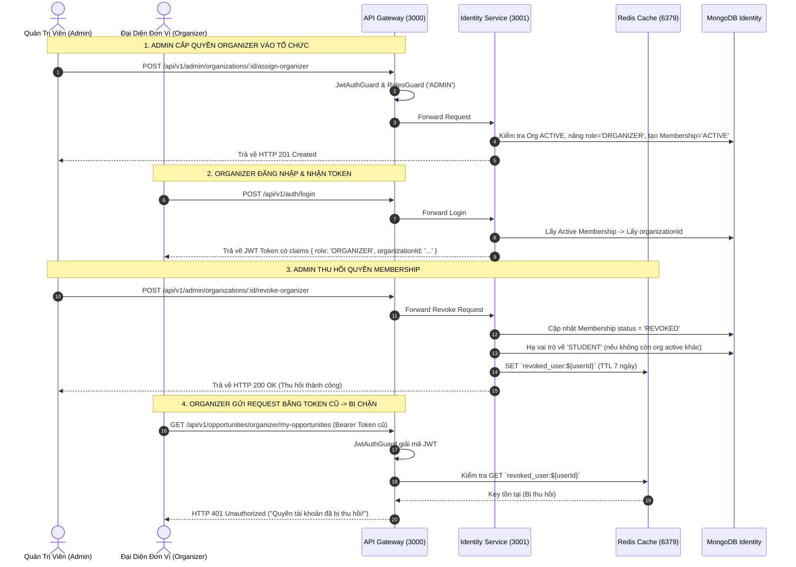

# Chức Năng 3: Web Admin, Quản Trị Tổ Chức & Phân Quyền Membership (SCHOL-14 Phần 1)

> **Mã công việc:** SCHOL-14 — [S4][Phú][BE] Web Admin/Organizer và bàn giao hệ thống  
> **Người thực hiện:** Bùi Đặng Vĩnh Phú (Backend Lead)  
> **Microservice đảm nhiệm:** `apps/identity-service` (Port 3001) & `apps/gateway` (Port 3000)  
> **Hạ tầng phối hợp:** MongoDB 7 (`scholink_identity`), Redis 7 (`Session Revocation & Rate Limit`)

---

## 1. Mục Tiêu Kỹ Thuật & Yêu Cầu An Ninh Đa Tầng

Trong một nền tảng B2B2C kết nối Nhà trường / Doanh nghiệp (`Organizers`) và Sinh viên (`Students`), quản lý phân quyền đa đơn vị (Multi-Tenancy) đòi hỏi:
1. **Phân quyền nghiêm ngặt theo vai trò (Role-Based Access Control - RBAC)**: Chỉ có tài khoản Quản trị viên cấp cao (`ADMIN`) mới có thẩm quyền tạo tổ chức đối tác, cấp quyền Organizer và thu hồi quyền.
2. **Thu hồi quyền lập tức có hiệu lực (Immediate Session Revocation)**: JWT là token phi trạng thái (Stateless), có thời hạn sống (ví dụ 15 phút). Nếu Admin thu hồi quyền của một Organizer xấu, họ không được phép tiếp tục thao tác bằng JWT cũ.
3. **Kiểm tra tư cách hoạt động (`ACTIVE Membership Enforcement`)**: Nếu đơn vị tổ chức bị tạm ngưng (`SUSPENDED`) hoặc tài khoản bị thu hồi quyền (`REVOKED`), toàn bộ các API quản lý tài nguyên của đơn vị đó phải bị từ chối ngay lập tức.
4. **Chống giả mạo danh tính tại biên (Identity Spoofing Prevention)**: Chặn client gửi kèm các header mạo danh như `x-user-id` hoặc `x-user-role`.

---

## 2. Kiến Trúc & Sơ Đồ Luồng Gọi Dịch Vụ



---

## 3. Lược Đồ Dữ Liệu & Thực Thể

Được định nghĩa tại [`organization.schema.ts`](file:///C:/Users/Administrator/Desktop/PROJECT/Scholink/backend/apps/identity-service/src/infrastructure/persistence/organization.schema.ts) và [`user.schema.ts`](file:///C:/Users/Administrator/Desktop/PROJECT/Scholink/backend/apps/identity-service/src/infrastructure/persistence/user.schema.ts):

### 3.1. Bảng `organizations`
- `id`: Mã định danh đơn vị (Ví dụ: `org_uit_cntt`, `org_vinai_001`).
- `name`: Tên đơn vị đối tác (Ví dụ: "Đại học Công nghệ Thông tin - ĐHQG TP.HCM").
- `taxCode`: Mã số thuế / Giấy phép thành lập.
- `status`: `'ACTIVE' | 'SUSPENDED' | 'INACTIVE'`.
- `version`: Phiên bản kiểm soát xung đột dữ liệu.

### 3.2. Bảng `organization_memberships`
- `id`: Mã quyền thành viên (`mem_org_<uuid>`).
- `organizationId`: Mã đơn vị trực thuộc.
- `userId`: Mã tài khoản người dùng được phân quyền.
- `role`: Vị trí trong đơn vị (`'OWNER' | 'ADMIN' | 'COORDINATOR' | 'REVIEWER'`).
- `status`: Trạng thái hiệu lực (`'ACTIVE' | 'REVOKED' | 'INVITED'`).
- `grantedBy`: ID của Admin phê duyệt cấp quyền.
- `grantedAt`: Thời điểm cấp quyền.

---

## 4. Chi Tiết Thực Thi Code (Code Walkthrough)

### 4.1. Cấp quyền Organizer và kiểm soát trạng thái đơn vị
Trong [`organization.use-case.ts`](file:///C:/Users/Administrator/Desktop/PROJECT/Scholink/backend/apps/identity-service/src/application/use-cases/organization.use-case.ts):

```typescript
async assignOrganizer(orgId: string, adminId: string, dto: AssignOrganizerDto) {
  const org = await this.orgModel.findOne({ id: orgId }).exec();
  if (!org) {
    throw DomainException.notFound('Đơn vị tổ chức');
  }

  // 1. Chặn gán thành viên nếu tổ chức đang bị đình chỉ
  if (org.status !== 'ACTIVE') {
    throw new DomainException(
      ErrorCode.STATE_CONFLICT,
      'Đơn vị tổ chức đang bị tạm dừng (SUSPENDED), không thể gán thành viên',
      409,
    );
  }

  const user = await this.userRepo.findByEmail(dto.userEmail);
  if (!user) {
    throw DomainException.notFound(`Người dùng với email ${dto.userEmail}`);
  }

  // 2. Nâng role lên ORGANIZER nếu đang là STUDENT
  if (user.role === 'STUDENT') {
    user.changeRole('ORGANIZER');
    await this.userRepo.update(user);
  }

  // 3. Khởi tạo bản ghi membership ACTIVE
  const membership = await this.membershipModel.findOneAndUpdate(
    { organizationId: orgId, userId: user.id },
    {
      $set: {
        role: dto.role,
        status: 'ACTIVE',
        grantedBy: adminId,
        grantedAt: new Date(),
      },
    },
    { upsert: true, new: true }
  );

  return { membership, user: { id: user.id, email: user.email, role: user.role } };
}
```

### 4.2. Thu hồi quyền và Blacklist Session qua Redis (Zero Stale Access)
Đây là kỹ thuật bảo mật cốt lõi để vô hiệu hóa token stateless:

```typescript
async revokeOrganizerMembership(orgId: string, adminId: string, dto: RevokeOrganizerDto) {
  const org = await this.orgModel.findOne({ id: orgId }).exec();
  if (!org) throw DomainException.notFound('Đơn vị tổ chức');

  const membership = await this.membershipModel.findOne({ organizationId: orgId, userId: dto.userId });
  if (!membership) throw DomainException.notFound('Quyền thành viên tại đơn vị này');

  // 1. Đổi trạng thái sang REVOKED
  membership.status = 'REVOKED';
  await membership.save();

  // 2. Kiểm tra xem người dùng còn org nào khác đang ACTIVE không
  const otherActive = await this.membershipModel.findOne({ userId: dto.userId, status: 'ACTIVE' });
  const user = await this.userRepo.findById(dto.userId);
  if (user && !otherActive && user.role === 'ORGANIZER') {
    user.changeRole('STUDENT');
    await this.userRepo.update(user);
  }

  // 3. Vô hiệu hóa toàn bộ session trong MongoDB và đẩy vào Redis Blacklist
  await this.userRepo.revokeAllUserSessions(
    dto.userId,
    `MEMBERSHIP_REVOKED: ${dto.reason || 'Admin thu hồi quyền'}`
  );

  return { message: 'Đã thu hồi thành công quyền thành viên', membership };
}
```

Tại tầng bảo vệ API Gateway ([`jwt-auth.guard.ts`](file:///C:/Users/Administrator/Desktop/PROJECT/Scholink/backend/libs/shared/src/infrastructure/guards/jwt-auth.guard.ts)):
```typescript
// Xóa toàn bộ header x-user-* do client giả mạo gửi lên
for (const headerKey of Object.keys(request.headers)) {
  if (headerKey.toLowerCase().startsWith('x-user-')) {
    delete request.headers[headerKey];
  }
}

// Kiểm tra Redis Blacklist tức thời (Độ trễ < 1ms)
if (this.redisService?.isAvailable) {
  const isUserRevoked = await this.redisService.get(`revoked_user:${authenticatedUser.userId}`);
  if (isUserRevoked) {
    throw new DomainException(
      ErrorCode.UNAUTHENTICATED,
      'Quyền hoặc thành viên của tài khoản đã bị thu hồi, vui lòng đăng nhập lại',
      401,
    );
  }
}
```

### 4.3. Bảo vệ lưu lượng với `RateLimitGuard` (Sliding Window Algorithm)
Trong [`rate-limit.guard.ts`](file:///C:/Users/Administrator/Desktop/PROJECT/Scholink/backend/libs/shared/src/infrastructure/guards/rate-limit.guard.ts):
- Mặc định: 120 yêu cầu / phút trên mỗi Client IP hoặc User ID.
- Sử dụng Redis làm bộ đếm phân tán (`INCR` + `EXPIRE`), tự động fallback sang `Map<string, { count, resetAt }>` trong bộ nhớ nếu Redis tạm dừng.
- Gắn các header phản hồi chuẩn RFC:
  - `X-RateLimit-Limit: 120`
  - `X-RateLimit-Remaining: 119`
  - `Retry-After: 60` (khi vượt quá ngưỡng, trả về HTTP 429 Too Many Requests).

---

## 5. Bằng Chứng Kiểm Thử Đạt Chuẩn (Verification Test Suite)

- **Tệp kiểm thử:** [`schol14-smoke.spec.ts`](file:///C:/Users/Administrator/Desktop/PROJECT/Scholink/backend/apps/gateway/src/schol14-smoke.spec.ts) và [`security-test.ts`](file:///C:/Users/Administrator/Desktop/PROJECT/Scholink/backend/scripts/security-test.ts).

### Kịch bản 1: Chỉ Admin được phép gọi API Quản trị Đơn vị
- **Kịch bản:** Tài khoản Student hoặc Organizer gọi `POST /api/v1/admin/organizations`.
- **Kết quả:** Gateway chặn đứng bằng `403 Forbidden` (`RolesGuard`). Chỉ tài khoản có `role: 'ADMIN'` mới được phép tiếp cận.

### Kịch bản 2: Vô hiệu hóa gán thành viên vào đơn vị bị `SUSPENDED`
- **Kịch bản:** Admin cập nhật đơn vị sang trạng thái `SUSPENDED`, sau đó cố tình gán một Organizer vào đơn vị này.
- **Kết quả:** Hệ thống từ chối với mã lỗi `409 Conflict` ("Đơn vị tổ chức đang bị tạm dừng (SUSPENDED), không thể gán thành viên").

### Kịch bản 3: Thu hồi quyền có hiệu lực ngay lập tức
- **Kịch bản:** Organizer đang có phiên đăng nhập hợp lệ. Admin gọi API thu hồi quyền. Ngay lập tức Organizer gửi request tiếp theo.
- **Kết quả:** Gateway kiểm tra Redis Blacklist và trả về `401 Unauthorized`. Quyền thành viên chuyển sang `REVOKED`.

---

## 6. Tóm Tắt Trả Lời Vấn Đáp Nhanh Cho Phú

- **Hỏi:** *Tại sao JWT đã ký số bí mật rồi mà vẫn cần Redis để kiểm tra thu hồi phiên?*
  - **Đáp:** JWT có tính chất Stateless (phi trạng thái) — một khi đã cấp phát, token vẫn có giá trị mã hóa cho đến khi hết hạn (Expires). Nếu không có cơ chế thu hồi, khi Admin tước quyền của một Organizer vi phạm, người đó vẫn có thể dùng token cũ trong 15 phút để truy cập dữ liệu nhạy cảm. Do đó, việc lưu danh sách đen (`Blacklist`) trên **Redis** với TTL ngắn tương đương thời gian token giúp hệ thống vừa giữ được ưu điểm giải mã nhanh của JWT, vừa bảo đảm khả năng **thu hồi tức thì trong 1 mili-giây**.
- **Hỏi:** *Làm thế nào để hệ thống ngăn chặn tấn công mạo danh Header (Header Spoofing)?*
  - **Đáp:** Tại tầng API Gateway, trước khi chuyển request vào sâu trong các vi dịch vụ, `JwtAuthGuard` sẽ duyệt qua toàn bộ HTTP request headers và xóa sạch (`delete request.headers[key]`) mọi header bắt đầu bằng tiền tố `x-user-*`. Sau đó, chỉ sau khi giải mã chữ ký mật mã của token JWT thành công, Gateway mới tự động gắn lại thông tin danh tính xác thực vào đối tượng `req.user`.
