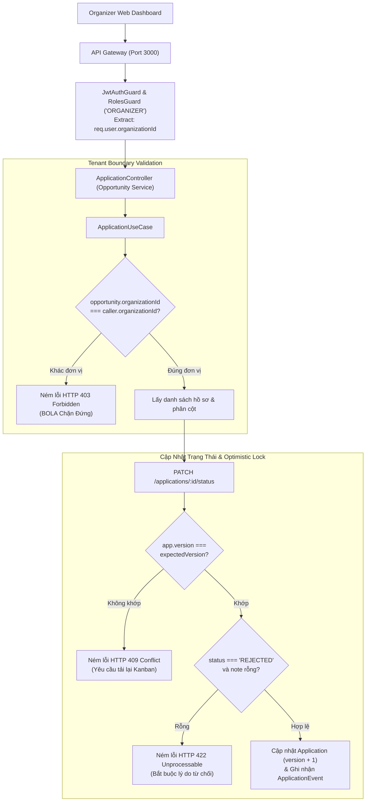

# Chức Năng 4: Web Organizer Kanban, Tenant Scoping & Sao Lưu / Phục Hồi Hệ Thống (SCHOL-14 Phần 2)

> **Mã công việc:** SCHOL-14 — [S4][Phú][BE] Web Admin/Organizer và bàn giao hệ thống  
> **Người thực hiện:** Bùi Đặng Vĩnh Phú (Backend Lead)  
> **Microservice đảm nhiệm:** `apps/opportunity-service` (Port 3002) & Bộ kịch bản sao lưu `backend/scripts/`  
> **Hạ tầng phối hợp:** MongoDB 7 (`scholink_opportunity`), Object Storage MinIO S3 (`storage/`)

---

## 1. Mục Tiêu Kỹ Thuật & Bài Toán Bàn Giao Hệ Thống

Chức năng điều phối của Ban Tổ Chức (Organizer) và bàn giao hệ thống giải quyết 4 yêu cầu sống còn:
1. **Cô lập dữ liệu đa người thuê (Multi-Tenant Isolation & BOLA Prevention)**: Ban tổ chức của Trường Đại học Công nghệ Thông tin (Org A) tuyệt đối không được phép xem trộm hoặc can thiệp vào hồ sơ ứng tuyển của Trường Đại học Khoa học Tự nhiên (Org B).
2. **Khóa lạc quan chống ghi đè đồng thời (Optimistic Locking Concurrency)**: Hai giám khảo cùng mở bảng Kanban, một người vừa duyệt chấp nhận (ACCEPTED) thì người kia không được phép vô tình ghi đè thành từ chối (REJECTED) trên phiên bản cũ.
3. **Kiểm toán minh bạch (Audit Trail) & Trách nhiệm giải trình**: Bất kỳ thao tác chuyển trạng thái nào đều phải ghi nhận danh tính giám khảo (`actorId`), và đặc biệt khi **Từ Chối (REJECTED)** bắt buộc phải cung cấp lý do (`note`) để giải thích cho thí sinh.
4. **Quy trình Sao lưu & Phục hồi có chứng minh tính đọc được (Proof of Readability)**: Không chỉ sao lưu DB dạng JSON mà phải sao lưu toàn bộ tệp nhị phân trong Object Storage kèm chữ ký số SHA-256; khi phục hồi vào môi trường test phải chứng minh được tệp mở ra đọc được nguyên vẹn 100%.

---

## 2. Kiến Trúc Phân Lớp & Sơ Đồ Điều Phối Kanban



---

## 3. Chi Tiết Thực Thi Code (Code Walkthrough)

### 3.1. Phân quyền và Chặn truy cập chéo đơn vị (Tenant Scoping)
Được triển khai tại [`application.use-case.ts`](file:///C:/Users/Administrator/Desktop/PROJECT/Scholink/backend/apps/opportunity-service/src/application/use-cases/application.use-case.ts):

```typescript
async getOpportunityKanban(opportunityId: string, caller: AuthenticatedUser) {
  const opportunity = await this.opportunityRepo.findById(opportunityId);
  if (!opportunity) {
    throw DomainException.notFound('Cơ hội (Học bổng / Cuộc thi)');
  }

  // SCHOL-14: Kiểm tra nghiêm ngặt ranh giới đơn vị tổ chức
  if (caller.role !== 'ADMIN') {
    if (!caller.organizationId || opportunity.props.organizationId !== caller.organizationId) {
      throw DomainException.forbidden('Bạn không có quyền truy cập hồ sơ của đơn vị khác');
    }
  }

  const applications = await this.applicationRepo.findManyByOpportunity(opportunityId);

  // Phân bổ hồ sơ thành 6 cột Kanban nghiệp vụ
  const columns: Record<string, any[]> = {
    SUBMITTED: [], REVIEWING: [], SHORTLISTED: [],
    INTERVIEW: [], ACCEPTED: [], REJECTED: [],
  };

  for (const app of applications) {
    const col = columns[app.status] ? app.status : 'SUBMITTED';
    columns[col].push({ ...app.props, id: app.id, version: app.version });
  }

  return {
    opportunityId,
    opportunityTitle: opportunity.props.title,
    totalApplications: applications.length,
    columns: {
      APPLIED: columns.SUBMITTED,
      REVIEWING: columns.REVIEWING,
      SHORTLISTED: columns.SHORTLISTED,
      INTERVIEW: columns.INTERVIEW,
      ACCEPTED: columns.ACCEPTED,
      REJECTED: columns.REJECTED,
    },
  };
}
```

### 3.2. Cập nhật trạng thái kèm Optimistic Locking & Audit Trail
```typescript
async updateStatus(
  applicationId: string,
  caller: AuthenticatedUser,
  dto: { status: string; expectedVersion?: number; note?: string }
) {
  const application = await this.applicationRepo.findById(applicationId);
  if (!application) throw DomainException.notFound('Hồ sơ ứng tuyển');

  const opportunity = await this.opportunityRepo.findById(application.opportunityId);
  if (!opportunity) throw DomainException.notFound('Cơ hội');

  // 1. Kiểm tra quyền sở hữu đơn vị
  if (caller.role !== 'ADMIN') {
    if (!caller.organizationId || opportunity.props.organizationId !== caller.organizationId) {
      throw DomainException.forbidden('Bạn không có quyền thay đổi trạng thái hồ sơ của đơn vị khác');
    }
  }

  // 2. Yêu cầu bắt buộc lý do khi từ chối hồ sơ (REJECTED)
  if (dto.status === 'REJECTED' && (!dto.note || !dto.note.trim())) {
    throw DomainException.unprocessable(
      ErrorCode.VALIDATION_ERROR,
      'Lý do từ chối (note) là bắt buộc khi chuyển trạng thái sang REJECTED',
    );
  }

  // 3. Khóa lạc quan (Optimistic Locking) chống xung đột phiên bản
  if (dto.expectedVersion !== undefined && application.version !== dto.expectedVersion) {
    throw new DomainException(
      ErrorCode.VERSION_MISMATCH,
      `Xung đột phiên bản dữ liệu (Expected: ${dto.expectedVersion}, Current: ${application.version}). Vui lòng tải lại bảng Kanban.`,
      409,
    );
  }

  // 4. Cập nhật trạng thái và tăng version
  const updated = application.changeStatus(dto.status as any);
  await this.applicationRepo.update(updated);

  // 5. Ghi nhận sự kiện kiểm toán bất biến (Audit Log)
  await this.applicationRepo.appendEvent({
    id: `evt_${crypto.randomUUID()}`,
    applicationId: updated.id,
    actorId: caller.userId,
    fromStatus: application.status,
    toStatus: updated.status,
    revision: updated.revision,
    reason: dto.note || 'ORGANIZER_STATUS_UPDATE',
  });

  return { applicationId: updated.id, status: updated.status, version: updated.version };
}
```

---

## 4. Cơ Chế Sao Lưu & Phục Hồi Kiểm Chứng Tính Đọc Được (F42)

Được triển khai trong hai kịch bản độc lập tại [`backend/scripts/backup.ts`](file:///C:/Users/Administrator/Desktop/PROJECT/Scholink/backend/scripts/backup.ts) và [`backend/scripts/restore.ts`](file:///C:/Users/Administrator/Desktop/PROJECT/Scholink/backend/scripts/restore.ts):

### 4.1. Quy trình Sao lưu Toàn diện (`pnpm run backup`)
1. **5 Database MongoDB**: Duyệt qua `scholink_identity`, `scholink_opportunity`, `scholink_collaboration`, `scholink_billing`, `scholink_notification`. Trích xuất toàn bộ collection thành các tệp JSON và tính mã băm **SHA-256**.
2. **Object Storage (`storage/`)**: Quét đệ quy toàn bộ thư mục lưu trữ CV, chứng chỉ, avatar. Sao chép và tính mã băm **SHA-256** của từng tệp nhị phân.
3. **Chữ ký số `manifest.json`**:
```json
{
  "version": "2.0",
  "backupId": "backup-2026-11-02T10-30-00-000Z",
  "createdAt": "2026-11-02T10:30:00.000Z",
  "checksumAlgorithm": "SHA-256",
  "databases": { ... },
  "objectStorage": {
    "filesCount": 2,
    "totalSizeBytes": 3072,
    "files": [
      {
        "relPath": "cvs/student_cv_nguyen_van_a.pdf",
        "sizeBytes": 1024,
        "sha256": "4a7d...b38e"
      }
    ]
  },
  "manifestSignature": "c83b...199a"
}
```

### 4.2. Quy trình Phục hồi & Báo cáo Kiểm chứng Tính Đọc Được (`pnpm run restore`)
Khác biệt hoàn toàn với các kịch bản sao chép thông thường, kịch bản `restore.ts`:
1. **Kiểm tra tính toàn vẹn Checksum**: Đối chiếu lại hash SHA-256 của từng tệp sao lưu trước khi nạp vào DB. Nếu phát hiện tệp bị hỏng, quá trình phục hồi lập tức dừng lại.
2. **Phục hồi Cơ sở dữ liệu**: Nạp lại documents vào MongoDB môi trường kiểm thử.
3. **Thao tác Đọc Tệp Nhị Phân Trực Tiếp (Proof of Readability)**:
   - Dùng `fs.openSync` mở file descriptor.
   - Đọc khối dữ liệu đầu (Header Preview / Magic Bytes).
   - Đọc toàn bộ nội dung nhị phân và đối chiếu lại mã SHA-256 trên đĩa.
   - Xuất bảng báo cáo nghiệm thu trực quan:

```text
========================================================================================
📊 BẢNG BÁO CÁO CHỨNG MINH TÍNH ĐỌC ĐƯỢC & TOÀN VẸN CỦA OBJECT STORAGE (READABILITY PROOF)
========================================================================================
Tên tệp                            | Dung lượng    | SHA-256     | Header xem trước          | Trạng thái đọc
-----------------------------------------------------------------------------------------
cvs/student_cv_nguyen_van_a.pdf    | 1024 B        | MATCH [OK]  | %PDF-1.4 %Scholink Verifi | ✅ READABLE (PASS)
certificates/ielts_certificate.pdf | 2048 B        | MATCH [OK]  | %PDF-1.4 %Scholink Verifi | ✅ READABLE (PASS)
========================================================================================
```

---

## 5. Bằng Chứng Kiểm Thử Đạt Chuẩn (Verification Test Suite)

- **Tệp kiểm thử:** [`schol14-smoke.spec.ts`](file:///C:/Users/Administrator/Desktop/PROJECT/Scholink/backend/apps/gateway/src/schol14-smoke.spec.ts) và CLI runner [`smoke-test-schol14.ts`](file:///C:/Users/Administrator/Desktop/PROJECT/Scholink/backend/scripts/smoke-test-schol14.ts).

### Kịch bản 1: Organizer A xem Kanban thành công, Organizer B bị chặn 403
- **Kịch bản:** Organizer A (UIT) truy cập cuộc thi của UIT -> Nhận danh sách 6 cột Kanban. Organizer B (HCMUS) cố tình gọi API với `opportunityId` của UIT.
- **Kết quả:** Organizer B bị ném lỗi `403 Forbidden` ("Bạn không có quyền truy cập hồ sơ của đơn vị khác").

### Kịch bản 2: Ngăn chặn ghi đè đồng thời (Optimistic Locking)
- **Kịch bản:** Hồ sơ đang ở `version: 1`. Organizer gửi yêu cầu cập nhật với `expectedVersion: 99`.
- **Kết quả:** Hệ thống từ chối với mã lỗi `409 Conflict` (`VERSION_MISMATCH`).

### Kịch bản 3: Bắt buộc lý do từ chối
- **Kịch bản:** Organizer chuyển trạng thái hồ sơ sang `REJECTED` nhưng để trống trường `note`.
- **Kết quả:** Hệ thống từ chối với mã lỗi `422 Unprocessable` ("Lý do từ chối (note) là bắt buộc khi chuyển trạng thái sang REJECTED").

---

## 6. Tóm Tắt Trả Lời Vấn Đáp Nhanh Cho Phú

- **Hỏi:** *Tại sao lại dùng Optimistic Locking thay vì Pessimistic Locking (Khóa dòng trong DB) khi cập nhật trạng thái Kanban?*
  - **Đáp:** Bảng Kanban có tần suất xem nhiều hơn ghi. Nếu dùng **Pessimistic Locking** (`db.collection.findAndModify` giữ khóa độc quyền), khi một giám khảo đang mở xem xét hồ sơ, các giám khảo khác sẽ bị treo request (Blocking), làm giảm thông lượng của hệ thống. **Optimistic Locking** cho phép mọi người cùng đọc song song, chỉ kiểm tra `version` tại thời điểm ghi. Nếu có xung đột, người đến sau chỉ cần tải lại thẻ hồ sơ mới nhất, tối ưu trải nghiệm và khả năng mở rộng (**High Scalability**).
- **Hỏi:** *Làm thế nào chứng minh được bản sao lưu không bị lỗi và tệp lưu trữ không bị hỏng sau khi restore?*
  - **Đáp:** Quy trình Restore của hệ thống được trang bị cơ chế tự động kiểm chứng 2 lớp: Lớp 1 đối chiếu mã băm **SHA-256** của từng tệp so với chữ ký lưu trong `manifest.json`. Lớp 2 thực hiện mở tệp nhị phân bằng file descriptor (`fs.openSync`), kiểm tra Magic Header Bytes (chuẩn nhận dạng tệp PDF/PNG) và xuất bảng báo cáo nghiệm thu `Readability Proof Table`. Điều này chứng minh tệp không chỉ tồn tại trên đĩa mà còn hoàn toàn đọc được bởi ứng dụng.
