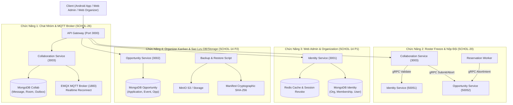

# Báo Cáo Kỹ Thuật & Sổ Tay Vấn Đáp Backend — Bùi Đặng Vĩnh Phú

> **Tác giả:** Bùi Đặng Vĩnh Phú (Backend Lead)  
> **Dự án:** Nền Tảng Học Bổng & Cuộc Thi Sinh Viên Toàn Diện — **Scholink Microservices Ecosystem**  
> **Nhánh phát triển:** `Phu` | **Release Tag:** `v1.0.0-release`  
> **Thư mục tài liệu:** `docs/Tai_lieu_cua_phu/`  
> **Mục đích:** Tài liệu báo cáo kiến trúc hệ thống, chi tiết mã nguồn, kịch bản kiểm thử và bộ câu hỏi trả lời vấn đáp bảo vệ đồ án/nghiệm thu kỹ thuật.

---

## 🗺️ Bản Đồ 4 Chức Năng Cốt Lõi Của Phú

Trong đợt phát triển này, Phú chịu trách nhiệm thiết kế kiến trúc và triển khai 4 module nghiệp vụ phức tạp nhất trong hệ thống phân tán Scholink:



---

## 📋 Danh Mục 4 Chức Năng & Các Tệp Tài Liệu Chuyên Sâu

| STT | Tên Chức Năng | Microservices Liên Quan | Giao Thức | Tệp Tài Liệu Chi Tiết |
|---|---|---|---|---|
| **1** | **Chat Nhóm Realtime & MQTT Reconnect (SCHOL-26)** | `collaboration-service`<br>`notification-service`<br>EMQX Broker | HTTP REST, MQTT (1883), Outbox Event | [`01_CHAT_NHOM_VA_MQTT_REALTIME_SCHOL26.md`](file:///C:/Users/Administrator/Desktop/PROJECT/Scholink/docs/Tai_lieu_cua_phu/01_CHAT_NHOM_VA_MQTT_REALTIME_SCHOL26.md) |
| **2** | **Roster Freeze, Consent Đội & Khóa Reservation (SCHOL-20)** | `collaboration-service`<br>`opportunity-service`<br>`identity-service` | HTTP REST, gRPC (50051, 50052), Background Worker | [`02_ROSTER_FREEZE_VA_RESERVATION_SCHOL20.md`](file:///C:/Users/Administrator/Desktop/PROJECT/Scholink/docs/Tai_lieu_cua_phu/02_ROSTER_FREEZE_VA_RESERVATION_SCHOL20.md) |
| **3** | **Web Admin, Quản Trị Tổ Chức & Phân Quyền Membership (SCHOL-14 P1)** | `identity-service`<br>`apps/gateway`<br>`libs/shared` | HTTP REST, JWT Claims, Redis Session Blacklist | [`03_WEB_ADMIN_ORGANIZATION_MEMBERSHIP_SCHOL14.md`](file:///C:/Users/Administrator/Desktop/PROJECT/Scholink/docs/Tai_lieu_cua_phu/03_WEB_ADMIN_ORGANIZATION_MEMBERSHIP_SCHOL14.md) |
| **4** | **Web Organizer Kanban, Tenant Scoping & Sao Lưu / Phục Hồi (SCHOL-14 P2)** | `opportunity-service`<br>`apps/gateway`<br>Backup/Restore Script | HTTP REST, Optimistic Lock, SHA-256 Manifest | [`04_ORGANIZER_KANBAN_VA_SAO_LUU_HE_THONG_SCHOL14.md`](file:///C:/Users/Administrator/Desktop/PROJECT/Scholink/docs/Tai_lieu_cua_phu/04_ORGANIZER_KANBAN_VA_SAO_LUU_HE_THONG_SCHOL14.md) |
| **5** | **Kiến Trúc Mobile: Flutter MVVM + Repository & Tích Hợp Cloud Firebase** | `mobile/lib/` (Flutter)<br>Firebase Auth, FCM, Storage | Dart 3.x, REST, MQTT, Sound Null-Safety | [`06_KIEN_TRUC_MOBILE_MVVM_REPOSITORY.md`](file:///C:/Users/Administrator/Desktop/PROJECT/Scholink/docs/Tai_lieu_cua_phu/06_KIEN_TRUC_MOBILE_MVVM_REPOSITORY.md) |
| **★** | **Bộ Câu Hỏi Vấn Đáp Chuyên Sâu & Kịch Bản Phản Biện (Oral Q&A)** | Toàn bộ 5 Microservices + Mobile | Toàn diện | [`05_BO_CAU_HOI_VAN_DAP_VA_TRA_LOI_PHAN_BIEN.md`](file:///C:/Users/Administrator/Desktop/PROJECT/Scholink/docs/Tai_lieu_cua_phu/05_BO_CAU_HOI_VAN_DAP_VA_TRA_LOI_PHAN_BIEN.md) |

---

## 🏛️ Tổng Quan Kiến Trúc & Luồng Gọi Giữa Các Dịch Vụ

### 1. Kiến trúc Clean Architecture / Hexagonal Architecture
Mỗi microservice tuân thủ nghiêm ngặt 4 lớp phân tầng:
- **Domain Layer (`domain/`)**: Thực thể (`Entity`), Giá trị bất biến (`Value Object`), Cổng trừu tượng (`Ports`). Không phụ thuộc bất kỳ framework hay database bên ngoài nào.
- **Application Layer (`application/`)**: Các Use Case xử lý luồng nghiệp vụ (`Use Cases`), Data Transfer Objects (`DTOs`), Zod Validation Schema.
- **Infrastructure Layer (`infrastructure/`)**: Triển khai Persistence (`Mongoose Repository`), Giao tiếp gRPC Client, Adapter Message Broker, Worker tiến trình nền.
- **Presentation Layer (`presentation/`)**: Controller tiếp nhận HTTP REST request và gRPC Server Handlers.

### 2. Giao tiếp Đồng bộ (Sync) vs Bất đồng bộ (Async)
- **Đồng bộ qua gRPC Binary Stream (Port 50051 - 50055)**:
  - Dùng khi cần phản hồi tức thì (Latency < 5ms).
  - Ví dụ: `Opportunity Service` gọi `Identity Service` xác thực chữ ký Consent và snapshot hồ sơ; `Reservation Worker` gọi `Opportunity Service` hủy phiên (`AbortSubmissionIntent`).
- **Bất đồng bộ qua Transactional Outbox Pattern**:
  - Dùng khi cần phát sự kiện tới Broker mà không làm chậm request của người dùng, hoặc khi Broker tạm thời gặp sự cố.
  - Ví dụ: Tin nhắn chat được commit vào DB MongoDB trước, ghi sự kiện vào bảng `outbox` trong cùng transaction, sau đó `OutboxWorker` phát lên EMQX Broker.

---

## ⚡ Hướng Dẫn Chạy Kiểm Thử Nhanh Trước Khi Vấn Đáp

Mọi kịch bản kiểm thử của 4 chức năng đều được tự động hóa 100%:

```bash
cd backend

# 1. Chạy Smoke Test tích hợp SCHOL-14 (Admin, Tenant Isolation, Chat Revoke, Crash Recovery)
pnpm run test:smoke

# 2. Chạy toàn bộ Unit & Integration tests của SCHOL-20, SCHOL-26, SCHOL-14
pnpm run test

# 3. Chạy kiểm thử an ninh bảo mật & OWASP (BOLA, NoSQL Injection, Rate Limiting)
pnpm run test:security

# 4. Kiểm tra quy trình Sao lưu và Phục hồi chứng minh tệp đọc được
pnpm run backup
pnpm run restore
```
